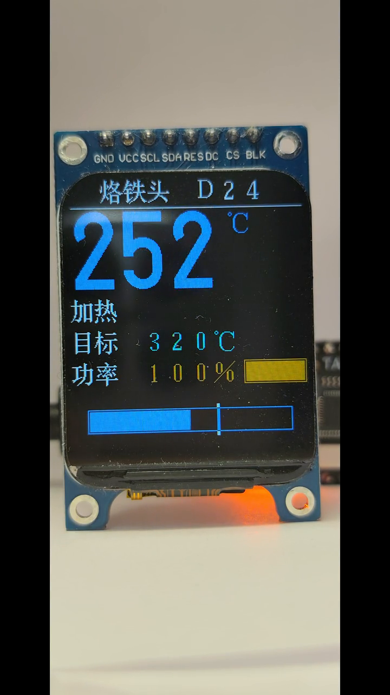
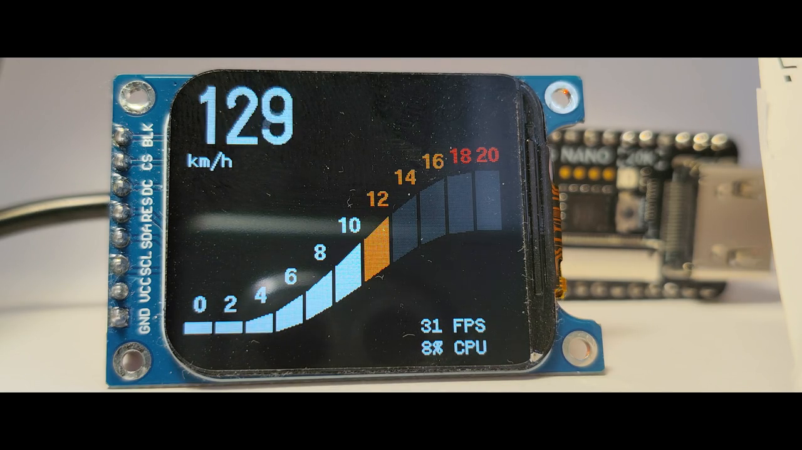
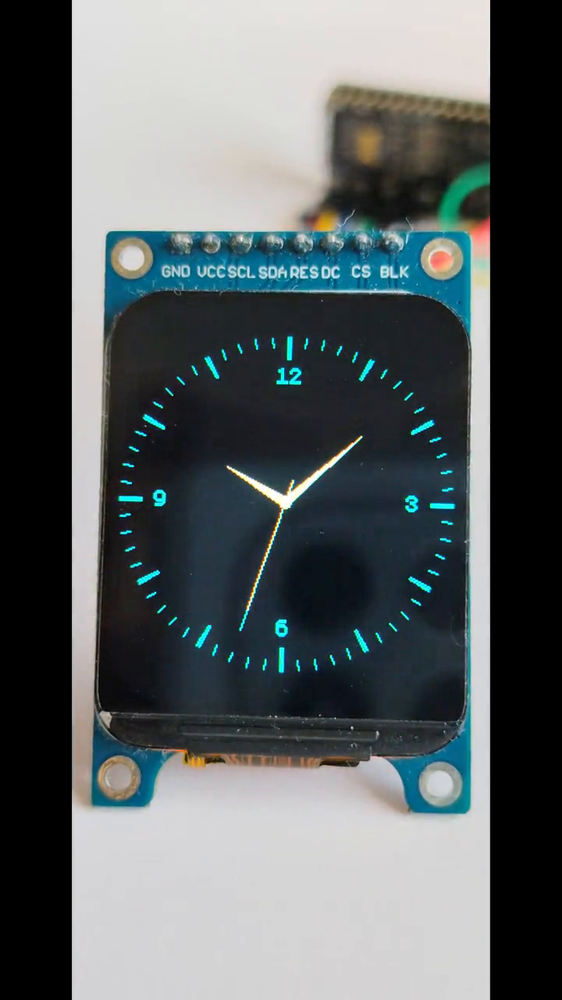

# clut-dma

Color for a 1 bpp frame buffer, in hardware.

The same expansion in software, no FPGA needed: [u8g2, branch clut](https://github.com/koendv/u8g2/tree/clut) for Arduino, [micropython-u8g2](https://github.com/koendv/micropython-u8g2) for MicroPython.

Demo of a soldering station. RISC-V, 24 MHz. SPI 12 MHz. 16 kB code, 2 kB RAM.

Demo of a speed gauge. Arm Cortex-M1, 54 MHz. SPI 27 MHz. 15 kB code, 2 kB RAM.

Demo of the u8g2 and Adafruit GFX graphics libraries. RAM from 1.5 to 9.7 kB, with a page buffer of one tile row to the full screen.

The display in the demos is an ST7789, 240×280.

# Description

The videos show a RISC-V and an Arm core, running inside a Tang Nano 20K FPGA.

The CPU draws a bitmap in black and white. A hardware DMA engine reads the bitmap from memory, and adds color while sending the image to the SPI display. No color frame buffer is needed. The graphics engine uses no multipliers, no block RAM.

The color is sufficient for a display on an industrial tool, but not for displaying photos or color gradients.

The advantage: easily sourced commodity displays, on microcontrollers too small for a color frame buffer.

# Comparison

A classic display stores the image as 16-bit RGB color per pixel. Updating the display is reading the frame buffer from memory with DMA, and sending it to the display with SPI.

Here the image is stored as:

- a bitmap of 1 bit per pixel;
- a tile map: the image is divided in tiles of 8×8 pixels, each tile has a 4-bit index;
- a color lookup table (CLUT) of 16 entries, each a foreground and a background color of 16-bit RGB.

Updating the display is reading the bitmap, the tile map and the CLUT from memory with DMA, converting each pixel to the foreground or background color of its tile, and sending it to the display with SPI. The conversion is simple enough to be done in hardware, between the DMA read and the SPI.

This is sufficient for user interfaces: text, numbers, menus, simple graphics, where a color per 8×8 tile is enough.

Memory for a full frame buffer, in bytes:

| display | 16-bit frame buffer | bitmap + tile map + CLUT |
|---|---|---|
| 128×160 | 40,960 | 2,784 |
| 240×240 | 115,200 | 7,714 |
| 240×280 | 134,400 | 8,989 |

A full frame buffer is usually preferred.
If needed, memory use can be reduced further:

- no tile map: less memory but single color only
- smaller buffer: less memory but slower.

For a 240-pixel-wide display, an 240×8-pixel page buffer, full-screen tile map and CLUT require only 829 bytes.

# Prototype

The deliverable is one Verilog file, [`rtl/clut_dma.v`](rtl/clut_dma.v).
Description in [`rtl/README.md`](rtl/README.md).

The engine is verified: invariants proven with SymbiYosys, output compared byte for byte with the u8g2 graphics library for 258 requests in simulation, and running on two FPGA builds.

Two FPGA bitstreams for the Tang Nano 20K run the same graphics engine:

- [Arm](fpga/tang_nano_20k_arm/README.md), Gowin Cortex-M1, 54 MHz
- [RISC-V](fpga/tang_nano_20k_riscv/README.md), Gowin GoRV32, 24 MHz

Both cores run the same demos.

# Demos

The demos show patterns of using clut_dma.

The u8g2 and Adafruit GFX demos use clut_dma as a drop-in. The drawing code does not change; one file replaces the software color expansion with a clut_dma request. This is the way to save memory.

The [async demo](fpga/tang_nano_20k_arm/README.md#auto-gauge-demo) sends the whole screen in one request, at the full speed of the SPI; an interrupt tells the CPU the screen is written. The CPU is free while clut_dma sends. This is the way to save time.

For fast updates, an icon is not redrawn:

- the icon is drawn once, at startup, all its tiles in one CLUT entry;
- to switch the icon off, set the foreground and background of the entry to the same color;
- to switch it on, set them to different colors.

The gauge of the async demo is animated this way: the band is drawn once, and lighting a segment is a CLUT write.

The [soldering station demo](fpga/tang_nano_20k_arm/README.md#soldering-station-demo) uses 24×24-pixel Chinese characters: a character is 3×3 tiles. When characters are a multiple of 8 pixels, each character can have its own colors ([rules](fpga/tang_nano_20k_arm/README.md#per-character-color)).

# Publication

The methods are disclosed in a [defensive publication](https://doi.org/10.5281/zenodo.23835660), so that they are prior art; the text is [clut-dma.md](clut-dma.md). The author does not seek patent rights on these methods, and covenants not to assert any patent covering them (section 8 of the publication).

# License

Code: BSD-2-Clause. Text of the publication: CC BY 4.0.

## See also

The same color expansion in software, without the DMA engine:

- [u8g2, branch clut](https://github.com/koendv/u8g2/tree/clut): u8g2 with color drivers for ST7789, ILI9341 and GC9A01 displays, for Arduino.
  `u8x8_clut_stream_rgb565()` and `u8x8_clut_stream_rgb444()` in `csrc/u8x8_clut.c` are the software version of the engine.
- [micropython-u8g2](https://github.com/koendv/micropython-u8g2): u8g2 graphics and mui menus for MicroPython, with the same color drivers.
