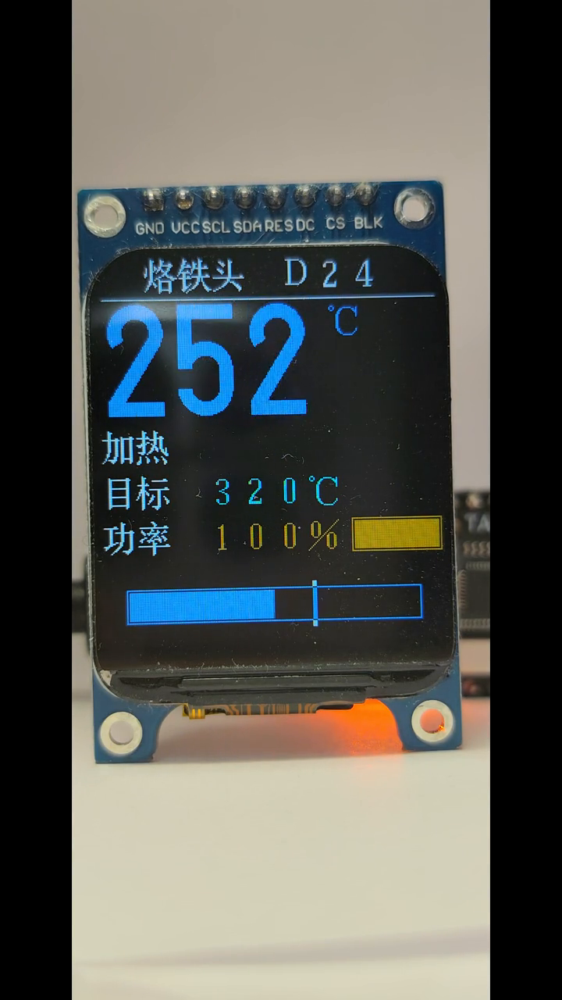
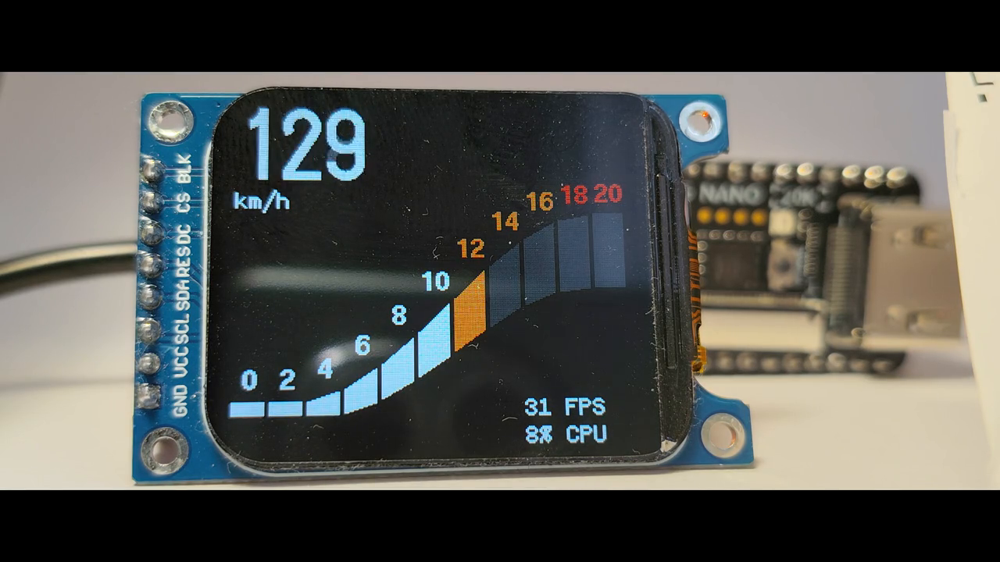
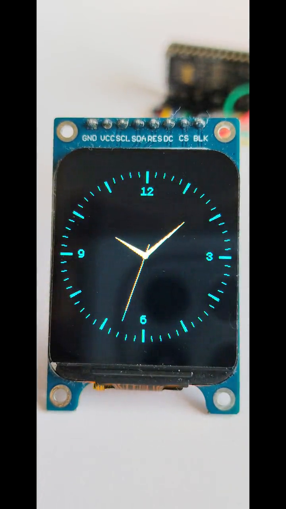
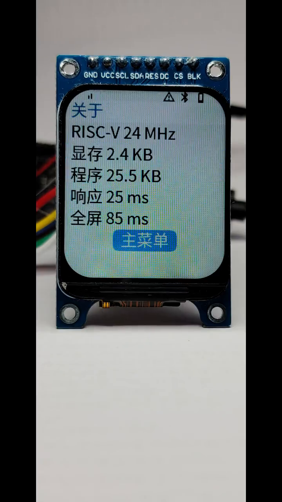
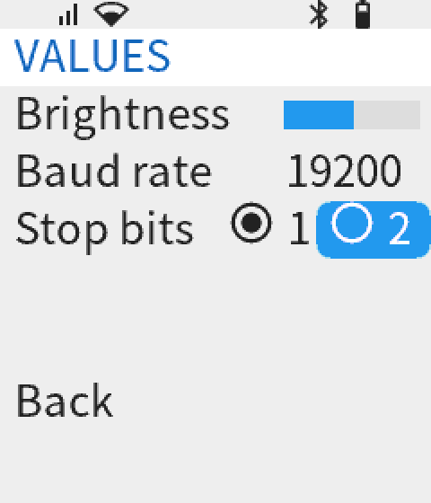
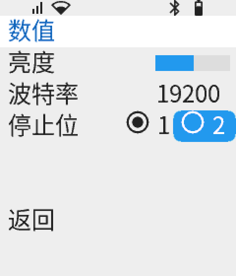
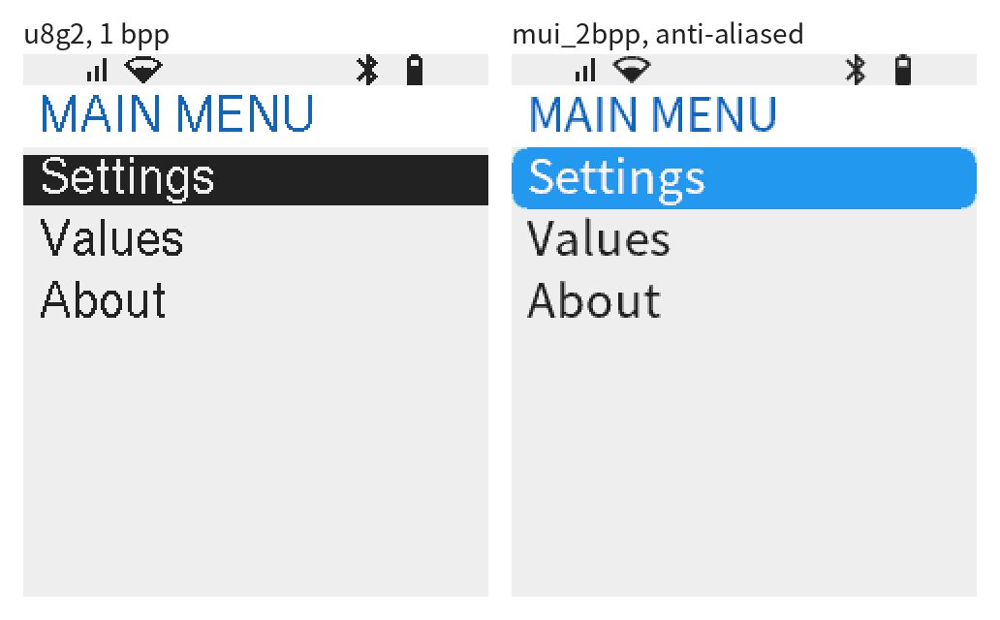

# clut-dma

Color for a 1 bpp frame buffer, in hardware. A simple graphics engine for microcontrollers.

Demo of a soldering station. RISC-V, 24 MHz. SPI 12 MHz. 15.2 KB code, 2 KB RAM (KB = 1024 bytes).

Demo of a speed gauge. Arm Cortex-M1, 54 MHz. SPI 27 MHz. 11.7 KB code, 9.5 KB RAM.

Demo of the u8g2 and Adafruit GFX graphics libraries. RAM from 1.5 to 9.5 KB, with a page buffer of one tile row to the full screen.

Demo of an anti-aliased menu, English and Chinese. RISC-V, 24 MHz. SPI 12 MHz. 25.5 KB code, of which 11.5 KB fonts; 3.3 KB RAM, of which 2.4 KB for the display. Focus change in 25 ms. Full screen update in 85 to 89 ms.

## Description

The videos show a RISC-V and an Arm core, running inside a Tang Nano 20K FPGA.
The display in the demos is an ST7789, 240×280.

To build and run the demos: [GETTING_STARTED.md](GETTING_STARTED.md).

The CPU draws a bitmap in black and white. A hardware DMA engine reads the bitmap from memory, and adds color while sending the image to the SPI display. No color frame buffer is needed. The graphics engine uses about 7,000 gates, no RAM.

The color is sufficient for a display on an industrial tool, but not for displaying photos or color gradients.

The advantage: easily sourced commodity displays, on microcontrollers too small for a color frame buffer.

## Comparison

A classic display stores the image as 16-bit RGB color per pixel. Updating the display is reading the frame buffer from memory with DMA, and sending it to the display with SPI.

Here the image is stored as:

- a bitmap of 1 bit per pixel;
- a tile map: the image is divided in tiles of 8×8 pixels, each tile has a 4-bit index;
- a color lookup table (CLUT) of 16 entries, each a foreground and a background color of 16-bit RGB.

Updating the display is reading the bitmap, the tile map and the CLUT from memory with DMA, converting each pixel to the foreground or background color of its tile, and sending it to the display with SPI. The conversion is simple enough to be done in hardware, between the DMA read and the SPI.

This is sufficient for user interfaces: text, numbers, menus, simple graphics, where a color per 8×8 tile is enough.

Memory for a full frame buffer, in bytes:

| display | 16-bit frame buffer | bitmap + tile map + CLUT |
|---|---|---|
| 128×160 | 40,960 | 2,784 |
| 240×240 | 115,200 | 7,714 |
| 240×280 | 134,400 | 8,989 |

A full frame buffer is the fastest, but uses the most memory.
If needed, memory use can be reduced further:

- no tile map: less memory but single color only
- smaller buffer: less memory but slower.

For a 240-pixel-wide display, a 240×8-pixel page buffer, full-screen tile map and CLUT require only 829 bytes.

## Modes

clut_dma has three modes:

- 1 bpp, row layout: The image is arranged in pixel rows, one byte is 8 pixels, 1 bit per pixel. Smallest in gates, simple, and the fewest memory reads: 10.9 words to draw a 8×8 tile. Suitable for Adafruit GFX, or Lovyan.
- 1 bpp, vertical layout: The image is arranged in 8×8 pixel tiles. 8 consecutive bytes are the 64 pixels of a 8×8 tile. This is the memory layout of the u8g2 graphics library. Memory reads: 24.7 words to draw a 8×8 tile.
- 2 bpp, row layout: The image is arranged in pixel rows, one byte is 4 pixels, 2 bits per pixel. Anti-aliasing, complex characters become legible. Compared to 1 bpp row layout, memory use and memory reads nearly double: 20.2 words to draw a tile. 2 bpp can also show up to 4 unrelated colors in one tile.

1 bpp vertical layout adds 6 % gates, 2 bpp 22 %. Both can be left out of synthesis with a switch.

| English | Chinese |
|---|---|
|  |  |

RAM for the display, 240×280, from 0.8 KB (1 bpp, one tile row) to 17.0 KB (2 bpp, full screen): [the table](mui_2bpp/README.md#frame-buffer).

## Anti-aliasing

1 bpp minimizes memory, but characters may look blocky or jagged.
For systems that have the memory, 2 bpp is still small, but allows anti-aliasing, for smooth, more natural-looking characters.

Comparison between 1 bit per pixel text and 2 bit per pixel anti-aliased text.

## Prototype

The graphics engine is one Verilog file, [`rtl/clut_dma.v`](rtl/clut_dma.v).
Description in [`rtl/README.md`](rtl/README.md).

The engine is verified: invariants proven with SymbiYosys, output compared byte for byte with the u8g2 graphics library for 258 requests in simulation, and running on two FPGA builds.

Two FPGA bitstreams for the Tang Nano 20K run the same graphics engine:

- [Arm](fpga/tang_nano_20k_arm/README.md), Gowin Cortex-M1, 54 MHz
- [RISC-V](fpga/tang_nano_20k_riscv/README.md), Gowin GoRV32, 24 MHz

Both cores run the same demos. Build instructions: [GETTING_STARTED.md](GETTING_STARTED.md).

## Demos

The demos show patterns of using clut_dma.

The u8g2 and Adafruit GFX demos use clut_dma as a drop-in. The drawing code does not change; one file replaces the software color expansion with a clut_dma request. This is the way to save memory.

The [speed gauge demo](fpga/tang_nano_20k_arm/README.md#speed-gauge-demo) sends the whole screen in one request, at the full speed of the SPI; an interrupt tells the CPU the screen is written. The CPU is free while clut_dma sends. This is the way to save time.

For fast updates, an icon is not redrawn:

- the icon is drawn once, at startup, all its tiles in one CLUT entry;
- to switch the icon off, set the foreground and background of the entry to the same color;
- to switch it on, set them to different colors.

The speed gauge is animated this way: the band is drawn once, and lighting a segment is a CLUT write.

The [soldering station demo](fpga/tang_nano_20k_arm/README.md#soldering-station-demo) uses 24×24-pixel Chinese characters: a character is 3×3 tiles. When characters are a multiple of 8 pixels, each character can have its own colors ([rules](fpga/tang_nano_20k_arm/README.md#per-character-color)).

A demo of an [anti-aliased menu](fpga/tang_nano_20k_riscv/README.md#anti-aliased-menu-demo) in English and Chinese, with the [menu system](mui_2bpp/README.md).

## License

Code: BSD-2-Clause. Text of the publication: CC BY 4.0.
The methods are free to use: they are published so that no one can patent them, and the author will not enforce patents on them ([publication](https://doi.org/10.5281/zenodo.23835660), section 8; source [clut-dma.md](clut-dma.md)).

## See also

The same color expansion in software, without the DMA engine:

- [u8g2, branch clut](https://github.com/koendv/u8g2/tree/clut): u8g2 with color drivers for ST7789, ILI9341 and GC9A01 displays, for Arduino.
- [micropython-u8g2](https://github.com/koendv/micropython-u8g2): u8g2 graphics and mui menus for MicroPython, with the same color drivers.
