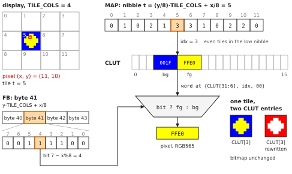
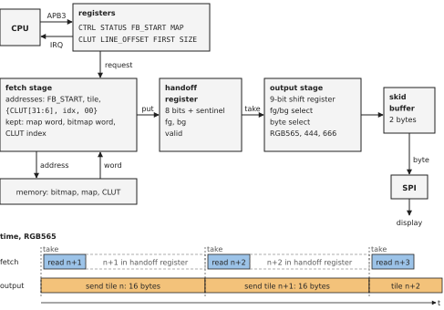

## Abstract

A frame buffer of 1 bit per pixel is divided in tiles of 8×8 pixels.
Each tile has a 4-bit index into a color lookup table (CLUT) of 16
foreground/background color pairs. A DMA engine in a microcontroller
(MCU) reads the bitmap, the tile index map and the CLUT, and produces
RGB565, RGB444 or RGB666 pixels on the fly, straight into a serial display
interface such as SPI. No color frame buffer exists anywhere. A 240×240
display needs 7.7 kB (7,714 bytes) of RAM instead of 115 kB (115,200
bytes) for a 16-bit frame buffer. 
The aim is to make color displays usable on microcontrollers that cannot afford a color frame buffer.
Changing a CLUT entry recolors every
tile that uses it, without redrawing. The engine has two
stages with one register between them: a fetch stage that reads memory
and an output stage that sends the bytes, so the memory reads of a tile
overlap the output of the previous tile. The same
expansion in the scan-out path of a display controller is also described.
Two anti-aliasing variants are also disclosed: 2 bits per pixel, and two
bit planes (section 6).
This document is a defensive publication: it discloses the methods
described, and the variants listed in section 6, so that they are prior
art.

Keywords: DMA, color lookup table, palette, bitmap, tile, frame buffer,
SPI display, microcontroller, anti-aliasing

## 摘要

**在 MCU DMA 引擎中利用按图块颜色查找表对 1bpp 帧缓冲区进行颜色扩展**

本文公开一种在微控制器（MCU）的 DMA 引擎中进行颜色扩展的方法。帧缓冲区为每像素
1 位（1bpp）的位图，按 8×8 像素的图块组织；每个图块有一个 4 位索引，指向包含 16
对前景色/背景色的颜色查找表（调色板，CLUT）。DMA 引擎在传输过程中读取位图、图块
索引表和调色板，实时生成 RGB565、RGB444 或 RGB666 像素，直接送入 SPI 等串行显示
接口。任何地方都不存在彩色帧缓冲区。240×240 显示屏只需 7.7 kB（7,714 字节）内存，而 16 位帧缓冲区需要
115 kB（115,200 字节）。目的是使无法负担彩色帧缓冲区的微控制器也能使用彩色显示屏。修改调色板中的一项即可改变所有使用该项的图块的颜色，无需重绘。引擎分为
两级，中间只有一个寄存器：读取内存的取数级和发送字节的输出级，因此一个图块的内存读取
与前一个图块的输出重叠进行。本文同时描述了显示控制器扫描输出中的这种扩展。此外还公开了两种抗锯齿变体：每像素 2 位，以及两个位平面（第 6 节）。本文为防御性公开，使所述方法及第 6 节列出的
变体成为公开的现有技术。
作者不寻求专利权，并欢迎将这些方法用于低成本微控制器的彩色显示。

关键词：DMA，颜色查找表，调色板，位图，图块，帧缓冲区，SPI 显示屏，微控制器，抗锯齿

## 1. Problem

Small color displays with an SPI interface (ST7789, ILI9341, GC9A01,
ILI9488) are cheap and common. The microcontrollers that drive them often
have 4 to 64 KiB of RAM. A frame buffer of 16 bits per pixel for a
240×240 display is 115,200 bytes, more than the RAM of such an MCU.
Today the options are: redraw in small parts, stream pre-rendered images
from external flash, or expand colors in software while sending, which
keeps the CPU busy. The goal of this work is to bring such displays within reach of low-cost MCUs.

For user interfaces (text, numbers, menus, simple graphics) color per pixel
is not needed. Color per 8×8 tile is enough. Graphics libraries such as
u8g2, LVGL and Adafruit GFX already draw in a 1-bit frame buffer. Adding a
color per tile turns them into color libraries, without changing the
drawing code.

## 2. Prior art

- ZX Spectrum (1982): 1-bit bitmap, one attribute byte per 8×8 cell, with
  3-bit ink and paper colors, bright and flash. The colors are in the
  attribute itself, not in a table.
- Commodore 64, high-resolution bitmap mode: 1-bit bitmap, 4-bit
  foreground and 4-bit background color per 8×8 cell, from a fixed
  palette.
- IBM VGA text mode: per character a 4-bit foreground and a 4-bit
  background index into 16 palette registers.
- Game consoles (NES, Sega Master System, SNES, Game Boy Color): per tile
  an index selects one of a few small palettes. On the Game Boy Color, 3
  bits select one of 8 palettes of 4 colors, for 2-bit tiles.
- STM32 DMA2D (Chrom-ART) and LTDC: L4 and L8 pixel formats, with a CLUT
  lookup per pixel. DMA2D also has A4 and A8 formats: a coverage value per
  pixel and one constant color, blended with a background image, memory to
  memory.

This publication differs in the combination: a 1-bit bitmap, or 2 bits for
blends of the pair, a per-tile index into a table of foreground/background
pairs, expanded during a DMA transfer from MCU memory into a serial display
interface, with no color frame memory in the MCU. DMA2D and LTDC look up a
CLUT entry per pixel, with 4 or 8 bits of index for every pixel, or blend
one constant color with a background image, and write the result to
memory or show a frame buffer on a parallel RGB panel. The game consoles
have per-tile palettes, but in a video controller with its own memory, not
during a DMA transfer from MCU memory.

## 3. Data model

Three areas in MCU memory, little-endian:

\needspace{7\baselineskip}

| area | contents | alignment |
|---|---|---|
| FB | bitmap, 1 bit per pixel, pixel row *y* is TILE_COLS bytes at FB + *y*·TILE_COLS | none |
| MAP | 4-bit CLUT index per tile, tile *t* is nibble *t* | 4 bytes |
| CLUT | 16 entries of 32 bits: foreground 15:0, background 31:16 | 64 bytes |

TILE_COLS is the number of tiles per tile row, the display width divided
by 8 and rounded up. In FB, a byte is 8 pixels of a pixel row, the
leftmost pixel in bit 7. This is the row layout of the 1-bit buffers of
u8g2 (horizontal buffer), LVGL (format I1) and Adafruit GFX (GFXcanvas1).
In MAP, an even tile is the low nibble of its byte. CLUT colors are
RGB565, or RGB444 in bits 11:0.

The color of pixel (*x*, *y*), as in figure 1:

```
t     = (y / 8) * TILE_COLS + x / 8
bit   = (FB[y * TILE_COLS + x / 8] >> (7 - x % 8)) & 1
idx   = MAP nibble t
color = bit ? CLUT[idx].fg : CLUT[idx].bg
```

{width=100%}

Memory, in bytes:

\needspace{7\baselineskip}

| display | 16-bit frame buffer | bitmap + map + CLUT |
|---|---|---|
| 128×160 | 40,960 | 2,560 + 160 + 64 = 2,784 |
| 240×240 | 115,200 | 7,200 + 450 + 64 = 7,714 |
| 240×280 | 134,400 | 8,400 + 525 + 64 = 8,989 |

With 8 KiB of RAM, the bitmap of a 240×240 display leaves too little
for the application; with a page buffer of a few tile rows it fits
(section 4.6).

Changing a CLUT entry recolors all tiles with that index at the next
transfer, without drawing. Changing a map nibble recolors one tile.

## 4. DMA engine

### 4.1 Registers and request

\needspace{11\baselineskip}

| offset | register | contents |
|---|---|---|
| 0x00 | CTRL | START, FORMAT (RGB565, RGB444, RGB666), IRQ_EN |
| 0x04 | STATUS | BUSY, DONE |
| 0x08 | FB_START | bitmap address of the top left pixel |
| 0x0C | MAP | tile map address; bits 1:0 ignored, read as 0 |
| 0x10 | CLUT | CLUT address; bits 5:0 ignored, read as 0 |
| 0x14 | LINE_OFFSET | bitmap bytes of a pixel row outside the rectangle |
| 0x18 | FIRST | top left tile of the rectangle |
| 0x1C | SIZE | W (bits 11:0) and H (bits 27:16), in pixels |

A request is a rectangle of W×H pixels, with its top left corner on the
corner of tile (*tx*, *ty*). The CPU sets the display window to the
rectangle (on an ST7789: CASET, RASET, RAMWR), writes FB_START = FB +
8·*ty*·TILE_COLS + *tx*, FIRST = *ty*·TILE_COLS + *tx*, LINE_OFFSET =
TILE_COLS − $\lceil W/8 \rceil$ and SIZE, and sets START. LINE_OFFSET is in bytes of
the bitmap, 8 pixels per byte, not in pixels as the line offset of other
2D DMA engines. The engine sends the rectangle, pixel row by pixel row, and sets
DONE when the last byte has left the engine. W and H need not be a
multiple of 8; for RGB444, W must be even. The whole screen is FB_START =
FB, FIRST = 0, LINE_OFFSET = 0, and W and H the size of the display.

As the address and count registers of a DMA channel, FB_START, FIRST and
H change during the transfer; the CPU writes them again for the next
request.

### 4.2 Sequence

```
repeat H times:                     pixel rows
  tile = FIRST
  repeat W / 8 rounded up times:    tiles
    idx    = MAP nibble tile
    fg, bg = CLUT word idx
    bits   = byte at FB_START
    for each bit, bit 7 first:      8 pixels, fewer in the last tile
      send(bit ? fg : bg)           2 or 3 bytes
    FB_START = FB_START + 1
    tile     = tile + 1
  FB_START = FB_START + LINE_OFFSET
  after every 8th pixel row: FIRST = tile + LINE_OFFSET
```

After the last tile of a pixel row, FB_START steps by LINE_OFFSET + 1 to
the same tile column in the next pixel row. After the last tile of a tile
row, the tile number steps by LINE_OFFSET + 1 to the next tile row, and
FIRST takes that value. Each is one adder with a 12-bit addend and a carry
in, in the same cycle as the step to the next tile: the end of a row costs
no extra cycle. After the last tile of the last pixel row the engine
stops.

Per tile and pixel row the engine needs three words:

- the map word at MAP + 4·(*t* >> 3), and nibble *t* & 7 of it;
- the CLUT word at {CLUT[31:6], idx, 00}: a concatenation, no adder.
  One read gives both foreground and background;
- the bitmap word at FB_START with bits 1:0 cleared, and byte FB_START &
  3 of it.

The fetch stage keeps the last map word it read, the last bitmap word and
the CLUT index of the last CLUT word. It reads a map word at the first
tile of a pixel row and at a multiple of 8 tiles, a bitmap word at the
first tile of a pixel row and at a word boundary, and a CLUT word when
the index changes. So a map word serves 8 tiles, a bitmap word 4 tiles,
and a CLUT word all following tiles with the same index. A change in
memory during a transfer may take effect only at the next read of that
word.

The engine has two stages that work in parallel, with a handoff register
between them:

- The fetch stage computes the addresses and does the reads of a tile and
  pixel row: 0 to 3 memory word reads, depending on which words it has
  kept. It puts the foreground, the background and the pixel
  bits in the handoff register, and starts on the next tile as soon as the
  output stage has taken the handoff register.
- The output stage takes the handoff register when it has sent the last
  byte of the previous tile, and sends the bytes of the pixels.

So the memory reads of a tile overlap the output of the previous tile
(figure 2). One
handoff register is enough with internal memory: the output of a whole
tile and pixel row, 12 to 24 bytes, takes longer than its at most 3 reads
(section 4.5).

{width=100%}

The output stage loads the pixel bits in a 9-bit shift register, with a
sentinel bit above the last pixel. The register is empty when only the
sentinel is left: no counter is needed for the pixels of a tile. In the
last tile of a pixel row the sentinel is put above the last pixel inside
W, so the tile ends early.

State of the fetch stage: two 12-bit counters, the tile number and the
tile within the pixel row, and a 3-bit pixel row counter; FB_START, FIRST and H count in place. The kept words: map
word and bitmap word of 32 bits, CLUT index of 4 bits and a valid bit.
Handoff register: 8 pixel bits and the sentinel, foreground, background
and a valid bit. Output stage: the 9-bit shift register, foreground,
background and a 3-bit one-hot byte select.

### 4.3 Output

The output is a byte stream with a valid/ready handshake, for a byte-wide
peripheral such as SPI. The bytes are those that u8g2 sends in software:

\needspace{7\baselineskip}

| format | bytes | shift per step | contents |
|---|---|---|---|
| RGB565 | 2 per pixel | 1 bit | most significant byte first |
| RGB444 | 3 per 2 pixels | 2 bits | R0G0, B0R1, G1B1 |
| RGB666 | 3 per pixel | 1 bit | R, G, B, 6 bits each in bits 7:2 |

For RGB666, the 5-bit red and blue of the RGB565 CLUT are extended to 6
bits by replicating the most significant bit (black and white stay
exact), or by shifting left one bit. The CLUT format does not change.

A 2-byte skid buffer sits between the output stage and the peripheral.
All outputs of the engine come from flip-flops. DONE and the interrupt are
set only when the handoff register, the output stage and the buffer are
empty: the last byte has left the engine. The peripheral may still hold
bytes in its data and shift registers; the CPU ends the transfer (chip
select, next window) when DONE is set and the peripheral is idle. With the
engine in the transmit path of the peripheral (section 4.6), DONE can
include the peripheral, so that DONE alone ends the transfer.

### 4.4 Size

A Verilog model (section 7) with an APB3 register port, synthesized with
Yosys 0.70 to generic 2-input gates: 416 flip-flops and about 1,550 gates
and multiplexers. 42 of the flip-flops are the handoff register, 69 hold
the kept words, and about 170 are the configuration and APB registers
(FB_START, MAP, CLUT, LINE_OFFSET, FIRST, SIZE, PRDATA); built into an
existing DMA channel, part of these are already there. The engine has no
RAM: no frame buffer, no line buffer, no CLUT storage.

In gate equivalents (NAND2 = 1; NOT 0.67; AND, OR 1.33; XOR, multiplexer
2.33; flip-flop 4.5, plus 1 with asynchronous reset, plus 1.5 with
enable) the engine is about 5,300, or about 4,100 without the
configuration and APB registers (`make size`). With the parameter CACHE = 0 the model
keeps no words and reads 3 words for every tile and pixel row: 352
flip-flops and about 4,500 gate equivalents. Synthesized with the same
flow and the same weights, two blocks that small microcontrollers often contain: a 32-bit hardware
divider (restoring, one bit per cycle, signed and unsigned, APB3 port) is
about 3,000 gate equivalents, and a CRC-32 unit (32 bits per cycle, APB3
port) about 1,600.

On an FPGA with 4-input LUTs, synthesized and placed with the tools of the
FPGA vendor, the engine with the kept words (CACHE = 1) takes 594 LUTs,
65 ALUs and 393 flip-flops, and no RAM. In the same design, a 32-bit
ARMv6-M (Cortex-M0 class) soft processor core, with debug, interrupt
controller, tightly coupled memories and a UART, takes 5,216 LUTs, 174
ALUs and 2,374 flip-flops, and 32 block RAMs for its memories. The engine is about
12\ % of the logic of the processor (LUTs and ALUs) and 17\ % of its
flip-flops. Measured as the difference between the whole design with and
without the engine.

### 4.5 Throughput

Measured on the Verilog model, with a memory read of 2 cycles plus *ws*
wait states, and an SPI with one data register and a shift register of
*P* cycles per byte. Two cases, each in RGB565, RGB444 and RGB666: three
whole 240×240 screens, 374,400 bytes; and three rectangles one tile wide
and 240 pixels high on a 320×240 display (TILE_COLS = 40), 12,480 bytes.

Memory reads per tile (64 pixels), the same for all *P* and *ws*: 10.9 on
whole screens with a random tile map, 3.5 on whole screens with one CLUT
index for all tiles, and 16.9 one tile wide. Without the kept words it is
24: 3 reads in each of the 8 pixel rows.

An underrun is a cycle in which the SPI shift register is idle during a
request. With the kept words there are none, in both cases, for *P* = 8,
16 and 32 and *ws* = 0, 1, 2, 4, 8, 16, 24 and 32. Without them (CACHE = 0, section 4.4) and
with the SPI at the system clock (*P* = 8), there are none up to 24 wait
states, and 2.1\ % at 32 wait states, in both cases. Internal SRAM of an
MCU has 0 to a few wait states; 16 to 32 wait states are external memory,
such as PSRAM over QSPI. The rectangle one tile wide has no more
underruns than the whole screens: the engine reads only the tiles inside
the rectangle, and goes to the next pixel row without extra cycles
(section 4.2). An underrun does not corrupt the image; it only costs
time.

### 4.6 Integration

The engine can be built as a mode of an existing DMA channel, which
already has the bus master, the address registers, the peripheral request
and the interrupt; the mode adds the MAP, CLUT and LINE_OFFSET registers and
the expansion. It can also be a separate engine between memory and the
peripheral, or part of the transmit path of the SPI peripheral itself.
The destination can be SPI, QSPI or a parallel (8080) display interface.

With page buffers, where the bitmap holds only a few tile rows, FB_START
points into the page buffer, and FIRST still addresses the tile map of
the whole screen. With a page buffer of one tile row, the display data of
a 240×280 display is 829 bytes: 240 bytes of bitmap, 525 bytes of tile map
and 64 bytes of CLUT. The drawing code then runs once per tile row; the
transfers stay the same.

With two page buffers used in turn, the CPU draws the next tile row in
one buffer while the engine sends the other, so drawing and sending
overlap. With page buffers of one tile row, the display data of a 240×280
display is then 1,069 bytes: 2 × 240 bytes of bitmap, 525 bytes of tile
map and 64 bytes of CLUT. The CPU writes the next window and request
after the previous transfer has ended (section 4.3). A CLUT change for
the next tile row goes into a second CLUT, and the next request points
CLUT at it, so the request in flight keeps its colors. A change in the
tile map reaches a request in flight only for the tiles inside that
request.

## 5. Display controller

The same expansion can sit in the scan-out path of a display controller.
The controller memory holds the 1-bit bitmap, the tile map and the CLUT;
the colors are produced while the panel is refreshed, and a CLUT write
takes effect at the next frame. In a full-color controller this is an
extra mode: the bitmap and map use a fraction of the color memory, the
rest can hold more bitmap pages or be powered down, and the MCU sends 1
bit per pixel instead of 16. A controller with only this mode needs about
17 times less display memory (240×320: 10.3 kB instead of 172.8 kB
at 18 bits per pixel).

## 6. Parameters and variants

In its general form, a bitmap of one or a few bits per pixel is divided in
tiles, and a map gives each tile an index into a table whose entries hold
two or more colors. While the image is moved from memory to a display, by
a DMA engine, a peripheral or a display controller, each pixel gets a
color of its tile's entry, selected by or computed from the pixel's bits,
in the pixel format of the display. No color image is stored. Changing an
entry recolors every tile that uses it. Sections 3 to 5 describe one form
of the method; the variants below can be combined with each other and
with it. Bit orders, byte orders, the positions of fields in words
and registers, register offsets and encodings in this document are
examples: the methods are the same with any other order, position or
encoding.

1. Tile size 8×8 pixels; also 8×16, 16×8, 16×16, or M×N.
2. CLUT index of 4 bits (16 entries); also 1 to 8 bits (2 to 256 entries).
3. CLUT entries of 32 bits holding an RGB565 or RGB444 pair; also entries
   of 64 bits holding an RGB666 or RGB888 pair, 128-byte aligned, at
   address `CLUT | idx << 3`.
4. Output RGB565, RGB444 (2 pixels in 3 bytes) or RGB666 (3 bytes per
   pixel), with RGB666 derived from RGB565 by bit replication or by
   shifting.
5. Output as bytes, or as 16-bit or 24-bit peripheral frames; either byte
   order.
6. Bitmap in row layout, leftmost pixel in bit 7 or in bit 0; also the
   tile layout of u8g2, where tile *t* is 8 bytes at FB + 8*t*, byte *c*
   is pixel column *c* and bit *r* is pixel row *r*. In the tile layout a
   tile and pixel row needs bit *r* of each of the 8 bytes, 2 word reads,
   and the same 2 words again in each of the 8 pixel rows of the tile.
7. Rectangle request (FB_START, FIRST, W, H, LINE_OFFSET); also a run of
   tiles within one tile row, whole tile rows, or a chain of requests in
   linked descriptors. The rectangle starts on a tile boundary; also on
   any pixel column, with the number of the first pixel in the first tile.
8. Addresses of the next pixel row: by adding a line offset, the bitmap
   bytes outside the rectangle, written by the CPU (section 4.2); by
   adding TILE_COLS − $\lceil W/8 \rceil$, computed by the engine from TILE_COLS and W;
   by adding TILE_COLS to the address of the first tile of the row, kept
   in a register of its own; or by stepping through all TILE_COLS tiles of
   the row and reading only those inside W, so that the addresses only
   increment. The line offset in bytes; also in pixels, of which the
   engine uses bits 14:3, for a bitmap whose width is a multiple of 8. The
   registers counted in place, or copies of them, leaving the registers
   the CPU wrote unchanged.
9. W in pixels, with the sentinel put above the last pixel inside W; also
   W in tiles, with the display window rounded up to a multiple of 8 when
   the display memory is larger than the glass. The same for H.
10. Output buffer of 2 bytes; also other depths.
11. Fetch stage and output stage with one handoff register; also a handoff
    buffer of more entries; the output stage in another block than the
    fetch stage, such as the transmit path of the peripheral, or in
    another clock domain; or one state machine that reads a tile and then
    sends it, without handoff register.
12. Keeping the last map word, bitmap word and CLUT word in the fetch
    stage; also keeping only some of them, none (3 reads per tile and
    pixel row), more words, or a line of map nibbles and CLUT words for
    the tiles of a tile row, used again in its 8 pixel rows. Keeping the
    words switched off at run time, so that every tile reads memory.
13. The engine as a mode of a DMA channel, as a separate engine, or in the
    transmit path of a serial peripheral.
14. The expansion in the scan-out path of a display controller, as an extra
    mode or as its only mode, with CLUT writes taking effect at a frame
    boundary.
15. Anti-aliased text and graphics through 2-bit coverage. With 2 bits
    per pixel, each pixel is the foreground, the background, or one of two
    blends between foreground and background. The CLUT is extended to four
    colors per index. One CLUT entry then is 64 bits holding four RGB565 or
    RGB444 colors, 128-byte aligned, at address `CLUT | idx << 3`: word 0
    is the 1-bit CLUT word, foreground in bits 15:0 and background in bits
    31:16, and word 1 holds the blend near the foreground in bits 15:0 and
    the blend near the background in bits 31:16. For RGB666 or RGB888, 128
    bits at `CLUT | idx << 4`, 256-byte aligned. The low bit of a pixel is
    the 1-bit image and the high bit marks a blend: 00 the background, 01
    the foreground, 10 the blend near the background, 11 the blend near
    the foreground. As in the 1-bit engine, the address selects the word,
    {CLUT[31:7], idx, high bit, 00}, a concatenation, no adder; the low bit
    selects the halfword in the output stage. The CPU computes the blends, with any
    weights or a gamma correction, and stores them in the CLUT. The fetch
    stage reads two 32-bit words from the CLUT when the index changes, and
    the output stage selects one of the four colors per pixel. At two bits
    per pixel, a byte holds 4 pixels, the leftmost in bits 7:6 or in bits
    1:0. A tile is 2 bytes of a pixel row, and a pixel row is 2·TILE_COLS
    bytes: FB_START = FB + 16·*ty*·TILE_COLS + 2·*tx*, LINE_OFFSET =
    2·(TILE_COLS − $\lceil W/8 \rceil$), and a bitmap word holds 2 tiles of a
    pixel row. The bitmap doubles (14.4 kB for 240×240), still far below a
    frame buffer, and fonts and lines get smooth edges. Also CLUT entries
    of two colors, with the blends computed by the engine, in the fetch
    stage when it reads a CLUT word or per pixel in the output stage, with
    weights that need only shifts and adds; and 4 bits per pixel with 14
    blends.
16. Anti-aliasing in two bit planes, with the CLUT entries of variant 15.
    The first plane is the 1-bit bitmap as before, the pixels with a
    coverage of a half or more; it gives the low bit of a pixel. The second
    plane, of the same size and layout, marks the pixels with a partial
    coverage; it gives the high bit. Without the second plane the engine
    reads only word 0 of a CLUT entry, the 1-bit CLUT word. The second
    plane is at a fixed offset from the first, its address computed with
    an adder or counted by a second pointer in step with FB_START; or at an
    aligned offset, so that its address differs from the first in one
    address bit. A graphics library draws in the first plane as with one
    bit per pixel; drawing in the first plane clears the second in the
    same pixels, and clearing the buffer clears both. Fonts have two
    planes per glyph; the first plane alone is the 1-bit glyph. Also more
    planes, for more blends.
17. Double buffering (section 4.6): two bitmaps, or two page buffers of
    one or more tile rows, used in turn; the CPU draws in one while the
    engine sends the other. Also more than two page buffers, in a ring.
    Also two CLUTs used in turn, each request pointing CLUT at the one the
    CPU does not change; and two tile maps in the same way. The CPU starts
    the next request when the previous transfer has ended (section 4.3),
    by polling or from the interrupt;
    the interrupt handler starts the request for the next buffer once the
    CPU has finished drawing it. Also the requests of the buffers queued as
    linked descriptors (variant 7).

## 7. Reference implementation

Software: the u8g2 graphics library with color drivers, branch `clut` of
`\mbox{\url{https://github.com/koendv/u8g2}}`{=latex}, commit
`6de49bb0b870d966f8056be9da6e57e9a1f8660f`. The functions
`u8x8_clut_stream_rgb565()` and `u8x8_clut_stream_rgb444()` in
`csrc/u8x8_clut.c` are the software version of the engine, for a bitmap
in the tile layout of u8g2. They drive ST7789, ILI9341 and GC9A01
displays, in Arduino and in MicroPython. On a Sunton ESP32-2424S012
(ESP32-C3, round 240×240 GC9A01), the MicroPython display driver,
including the bitmap and tile map, uses 8,384 bytes of heap.

Hardware: a Verilog model of the engine (`rtl/clut_dma.v`), in the files
accompanying this record and in
`\mbox{\url{https://github.com/koendv/clut-dma}}`{=latex}, tag `v1.0`.
The testbench puts the pixels of each request
in the tile layout of u8g2, and compares the bytes from the model with
the bytes from `u8x8_clut_stream_rgb565()` and `u8x8_clut_stream_rgb444()`
of u8g2, for 105 requests in the three formats, with random memory
latency and random output stalls. It also checks the number of memory
reads of each request, and the values of FB_START, FIRST and H at the
end. The same tests pass with CACHE = 0. The register port is proven
against APB3 properties, and invariants of the state of the engine and
of its memory and byte stream interfaces are proven by induction, with
SymbiYosys (files in `formal/`).

The model also ran on an FPGA, next to a 32-bit ARMv6-M soft processor
core that writes the registers, a block RAM for bitmap, map and CLUT,
and an SPI to a 240×280 display (files in `fpga/`). With the SPI clock at
half the system clock, every request sent its bytes in 16.0 system clock
cycles per byte, the shortest possible: the SPI never waited for the
engine, for whole screens in the three formats and for rectangles down
to one tile wide. Example programs of the u8g2 branch (a palette, a
dashboard with color changes, an analog clock, the graphics test and a
menu) ran through a u8g2 display driver that turns each tile row u8g2
sends into a request. With a full bitmap they need about 10 kB of
RAM in all; with a page buffer of one tile row the display data is 829
bytes (section 4.6). A simulation of the model with a model of the
display gives the image each program ought to show.

## 8. License

This text: CC BY 4.0. The Verilog model, the testbenches, the formal
properties, the firmware and the scripts: BSD-2-Clause. The soft
processor core of the FPGA prototype is IP of the FPGA vendor and is not
included; only its configuration file is.

The author does not seek patent rights on these methods, and invites their use to bring color displays to low-cost microcontrollers.
