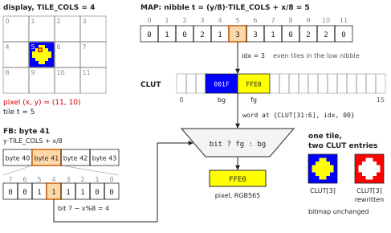
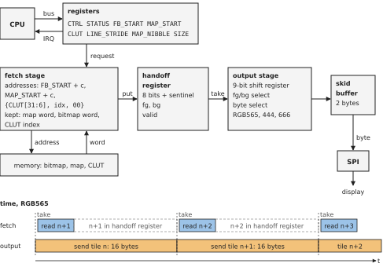

## Abstract

A frame buffer of 1 bit per pixel is divided in tiles of 8×8 pixels.
Each tile has a 4-bit index into a color lookup table (CLUT) of 16
foreground/background color pairs. A DMA engine in a microcontroller
(MCU) reads the bitmap, the tile index map and the CLUT, and produces
RGB565, RGB444 or RGB666 pixels on the fly, straight into a serial display
interface such as SPI. No color frame buffer exists anywhere. A 240×240
display needs 7.7 kB (7,714 bytes) of RAM instead of 115 kB (115,200
bytes) for a 16-bit frame buffer.
The aim is to make color displays usable on microcontrollers that cannot afford a color frame buffer.
Changing a CLUT entry recolors every
tile that uses the CLUT entry, without redrawing in software. The engine has two
stages with one register between them: a fetch stage that reads memory
and an output stage that sends the bytes, so the memory reads of a tile
overlap the output of the previous tile. The same
expansion in the scan-out path of a display controller is also described.
Two anti-aliasing variants are also disclosed: 2 bits per pixel, and two
bit planes (section 6).
This document is a defensive publication: it discloses the methods
described, and the variants listed in section 6, so that they are prior
art.

Keywords: DMA, color lookup table, palette, bitmap, tile, frame buffer,
SPI display, microcontroller, anti-aliasing

CPC: G09G 5/06, G09G 5/395, G09G 5/399, G09G 2340/08, G09G 2360/122,
G09G 2350/00, G09G 2310/04, G06F 13/28, G06T 2200/12

## 摘要

**在 MCU DMA 引擎中利用逐图块颜色查找表对 1bpp 帧缓冲区进行颜色扩展**

本文公开一种在微控制器（MCU）的 DMA 引擎中进行颜色扩展的方法。帧缓冲区为每像素
1 位（1bpp）的位图，按 8×8 像素的图块组织；每个图块有一个 4 位索引，指向包含 16
对前景色/背景色的颜色查找表（调色板，CLUT）。DMA 引擎在传输过程中读取位图、图块
索引表和调色板，实时生成 RGB565、RGB444 或 RGB666 像素，直接送入 SPI 等串行显示
接口。全程无需彩色帧缓冲区。240×240 显示屏只需 7.7 kB（7,714 字节）内存，而 16 位帧缓冲区需要
115 kB（115,200 字节）。目的是使无法负担彩色帧缓冲区的微控制器也能使用彩色显示屏。修改调色板中的一项即可改变所有使用该项的图块的颜色，无需软件重绘。引擎分为
两级，中间只有一个寄存器：读取内存的取数级和发送字节的输出级，因此一个图块的内存读取
与前一个图块的输出重叠进行。本文同时描述了显示控制器扫描输出路径中的这种扩展。此外还公开了两种抗锯齿变体：每像素 2 位，以及两个位平面（第 6 节）。本文为防御性公开，使所述方法及第 6 节列出的
变体成为公开的现有技术。
作者不寻求专利权，并承诺不就本文所公开的方法主张任何专利权，欢迎将这些方法用于低成本微控制器的彩色显示。

关键词：DMA，直接存储器访问，颜色查找表，色彩查找表，调色板，索引色，位图，单色位图，图块，瓦片，帧缓冲区，帧缓存，显存，前景色，背景色，颜色扩展，单色转彩色，SPI 显示屏，串行外设接口，彩色液晶屏，微控制器，单片机，抗锯齿

分类号（CPC）：G09G 5/06, G09G 5/395, G09G 5/399, G09G 2340/08, G09G 2360/122,
G09G 2350/00, G09G 2310/04, G06F 13/28, G06T 2200/12

## 1. Problem

Small color displays with an SPI interface (ST7789, ILI9341, GC9A01,
ILI9488) are cheap and common. The microcontrollers that drive them often
have 4 to 64 KiB of RAM. A frame buffer of 16 bits per pixel for a
240×240 display is 115,200 bytes, more than the RAM of such an MCU.
Today the options are: redraw in small parts, stream pre-rendered images
from external flash, or expand colors in software while sending, which
keeps the CPU busy. The goal of this work is to bring such displays within reach of low-cost MCUs.

For user interfaces (text, numbers, menus, simple graphics) color per pixel
is not needed. Color per 8×8 tile is enough. Graphics libraries such as
u8g2 and Adafruit GFX already draw in a 1-bit frame buffer. Adding a
color per tile turns them into color libraries, without changing the
drawing code.

## 2. Prior art

- ZX Spectrum (1982): 1-bit bitmap, one attribute byte per 8×8 cell, with
  3-bit ink and paper colors, bright and flash. The colors are in the
  attribute itself, not in a table.
- Commodore 64, high-resolution bitmap mode: 1-bit bitmap, 4-bit
  foreground and 4-bit background color per 8×8 cell, from a fixed
  palette.
- IBM VGA text mode: per character a 4-bit foreground and a 4-bit
  background index into 16 palette registers.
- Game consoles (NES, Sega Master System, SNES, Game Boy Color): per tile
  an index selects one of a few small palettes. On the Game Boy Color, 3
  bits select one of 8 palettes of 4 colors, for 2-bit tiles.
- STM32 DMA2D (Chrom-ART) and LTDC: L4 and L8 pixel formats, with a CLUT
  lookup per pixel. DMA2D also has A4 and A8 formats: a coverage value per
  pixel and one constant color, blended with a background image, memory to
  memory.

This publication differs in the combination: a 1-bit bitmap, or 2 bits for
blends of the pair, a per-tile index into a table of foreground/background
pairs, expanded during a DMA transfer from MCU memory into a serial display
interface, with no color frame memory in the MCU. DMA2D and LTDC look up a
CLUT entry per pixel, with 4 or 8 bits of index for every pixel, or blend
one constant color with a background image, and write the result to
memory or show a frame buffer on a parallel RGB panel. The game consoles
have per-tile palettes, but in a video controller with its own memory, not
during a DMA transfer from MCU memory.

## 3. Data model

Three areas in MCU memory, little-endian:

\needspace{7\baselineskip}

| area | contents | alignment |
|---|---|---|
| FB | bitmap, 1 bit per pixel, in the row layout or the tile layout | none (row), 8 bytes (tile) |
| MAP | 4-bit CLUT index per tile, tile *t* is nibble *t* | none |
| CLUT | 16 entries of 32 bits: foreground 15:0, background 31:16 | 64 bytes |

TILE_COLS is the number of tiles per tile row, the display width divided
by 8 and rounded up. The bitmap is in one of two layouts:

- Row layout: pixel row *y* is TILE_COLS bytes at FB + *y*·TILE_COLS; a
  byte is 8 pixels of a pixel row, the leftmost pixel in bit 7. This is
  the layout of the 1-bit buffers of u8g2 (horizontal buffer), LVGL
  (format I1) and Adafruit GFX (GFXcanvas1).
- Tile layout, the vertical layout of u8g2: tile *t* is 8 bytes at FB +
  8·*t*; byte *c* is pixel column *c* of the tile, bit *r* is pixel row *r*,
  the top pixel in bit 0.

In MAP, an even tile is the low nibble of its byte. CLUT colors are
RGB565, or RGB444 in bits 11:0.

The color of pixel (*x*, *y*), as in figure 1 for the row layout:

```
t     = (y / 8) * TILE_COLS + x / 8
bit   = (FB[y * TILE_COLS + x / 8] >> (7 - x % 8)) & 1     row layout
bit   = (FB[8 * t + x % 8] >> (y % 8)) & 1                 tile layout
idx   = MAP nibble t
color = bit ? CLUT[idx].fg : CLUT[idx].bg
```

{width=100%}

Memory, in bytes:

\needspace{7\baselineskip}

| display | 16-bit frame buffer | bitmap + map + CLUT |
|---|---|---|
| 128×160 | 40,960 | 2,560 + 160 + 64 = 2,784 |
| 240×240 | 115,200 | 7,200 + 450 + 64 = 7,714 |
| 240×280 | 134,400 | 8,400 + 525 + 64 = 8,989 |

With 8 KiB of RAM, the bitmap of a 240×240 display leaves too little
for the application; with a page buffer of a few tile rows it fits
(section 4.6).

Changing a CLUT entry recolors all tiles with that index at the next
transfer, without drawing. Changing a map nibble recolors one tile.

## 4. DMA engine

### 4.1 Registers and request

\needspace{18\baselineskip}

| offset | register | contents |
|---|---|---|
| 0x00 | CTRL | START, FORMAT (RGB565, RGB444, RGB666), IRQ_EN, VERT (tile layout), NO_MAP |
| 0x04 | STATUS | BUSY, DONE, ERR |
| 0x08 | FB_START | bitmap address of the first tile |
| 0x0C | MAP_START | map byte with the entry of the first tile |
| 0x10 | CLUT | CLUT address; bits 5:0 ignored, read as 0 |
| 0x14 | LINE_STRIDE | bitmap bytes from a line to the next |
| 0x18 | MAP_NIBBLE | the nibble of MAP_START: 0 low, 1 high |
| 0x1C | SIZE | W (bits 11:0) and H (bits 27:16), in pixels |

A request is a rectangle of W×H pixels, with its top left corner on the
corner of tile (*tx*, *ty*), *t* = *ty*·TILE_COLS + *tx*. The CPU sets
the display window to the rectangle (on an ST7789: CASET, RASET, RAMWR)
and writes:

- FB_START, the bitmap address of tile *t*: in the row layout the byte of
  the top left pixel, FB + 8·*ty*·TILE_COLS + *tx*; in the tile layout the
  first byte of the tile, FB + 8·*t*, which is the tile pointer a
  graphics library in that layout already has.
- MAP_START = MAP + $\lfloor t/2 \rfloor$ and MAP_NIBBLE = *t* & 1: the map entry of
  tile *t*, at nibble resolution.
- LINE_STRIDE, the bitmap bytes from a line to the next: TILE_COLS in the
  row layout, where a line is a pixel row; 8·TILE_COLS in the tile
  layout, where a line is a tile row. The map has as many tiles per tile
  row as the bitmap, so its stride follows from LINE_STRIDE.
- SIZE, and CTRL with START, FORMAT, IRQ_EN, VERT for the tile layout, and
  NO_MAP.

The engine sends the rectangle, pixel row by pixel row, and sets DONE
when the last byte has left the engine. W and H need not be a multiple
of 8; for RGB444, W must be even. The whole screen is FB_START = FB,
MAP_START = MAP, MAP_NIBBLE = 0, and W and H the size of the display.

With NO_MAP set, the engine reads no map: every tile uses CLUT entry 0,
and MAP_START and MAP_NIBBLE are not used. A plain 1-bit bitmap is then
sent with one color pair, and the CLUT is a single word: with white as all
ones and black as all zeros, 0x0000FFFF is white on black and 0xFFFF0000
black on white, in RGB565, RGB444 and RGB666 alike.

As the address and count registers of a DMA channel, FB_START,
MAP_START, MAP_NIBBLE and H change during the transfer; the CPU writes
them again for the next request.

### 4.2 Sequence

```
repeat H times:                           pixel rows; r = pixel row in the tile
  for c = 0 to W / 8 rounded up − 1:      tiles of the pixel row
    idx    = NO_MAP ? 0 : map nibble 2·MAP_START + MAP_NIBBLE + c
    fg, bg = CLUT word idx
    bits   = byte at FB_START + c                    row layout
           = bit r of the 8 bytes at FB_START + 8c   tile layout
    for each pixel, leftmost first:       8 pixels, fewer in the last tile
      send(bit ? fg : bg)                 2 or 3 bytes; RGB444: 3 per 2 pixels
  row layout: FB_START = FB_START + LINE_STRIDE
  after every 8th pixel row:
    tile layout: FB_START = FB_START + LINE_STRIDE
    MAP_START, MAP_NIBBLE = + LINE_STRIDE nibbles (row layout)
                            + LINE_STRIDE / 8 nibbles (tile layout)
```

The address of tile *c* of a pixel row is FB_START + *c*, or FB_START + 8*c*
in the tile layout, and its map entry is *c* nibbles after MAP_START and
MAP_NIBBLE: one adder each. In the last cycle of a line, the same adder
adds LINE_STRIDE instead, and FB_START or MAP_START takes the sum: the
end of a line costs no extra cycle. W is split into W bits 11:3 full tiles
and a last tile of W bits 2:0 pixels; the last tile of a pixel row is found
by comparing *c* with W bits 11:3 when there is a partial tile, and *c* + 1
otherwise; *c* + 1 is the increment of the tile counter, so no adder is
needed. After the last tile of
the last pixel row the engine stops.

Per tile and pixel row the engine needs three words in the row layout:

- the map word holding the entry: with *m* = 2·MAP_START + MAP_NIBBLE + *c*,
  the nibble address of the entry, the word at byte address 4·(`m >> 3`),
  and nibble *m* & 7 of it. Every read is an aligned word; the nibble is
  selected in the word;
- the CLUT word at {CLUT[31:6], idx, 00}: a concatenation, no adder.
  One read gives both foreground and background;
- the bitmap word at FB_START + *c* with bits 1:0 cleared, and byte
  (FB_START + *c*) & 3 of it.

In the tile layout, the pixels of a tile and pixel row are bit *r* of each
of the 8 bytes of the tile: the engine reads the 2 bitmap words of the
tile and keeps bit *r* of each byte. The map word and CLUT word are as in
the row layout.

The fetch stage keeps the last map word it read, the last bitmap word and
the CLUT index of the last CLUT word. It reads a map word at the first
tile of each pixel row and when *m* & 7 is 0, a bitmap word at the first
tile of each pixel row and at a word boundary, and a CLUT word when the index changes. So a
map word serves 8 tiles, a bitmap word 4 tiles in the row layout, and a
CLUT word all following tiles with the same index. In the tile layout the
2 bitmap words of a tile are read again in each of its 8 pixel rows. A
change in memory during a transfer may take effect only at the next read
of that word.

The engine has two stages that work in parallel, with a handoff register
between them:

- The fetch stage computes the addresses and does the reads of a tile and
  pixel row: 0 to 3 memory word reads in the row layout, 2 to 4 in the
  tile layout, depending on which words it has kept. It puts the foreground, the background and the pixel
  bits in the handoff register, and starts on the next tile as soon as the
  output stage has taken the handoff register.
- The output stage takes the handoff register when it has sent the last
  byte of the previous tile, and sends the bytes of the pixels.

So the memory reads of a tile overlap the output of the previous tile
(figure 2). One
handoff register is enough with internal memory: the output of a whole
tile and pixel row, 12 to 24 bytes, takes longer than its at most 3 or 4
reads (section 4.5).

{width=100%}

The output stage loads the pixel bits in a 9-bit shift register, with a
sentinel bit above the last pixel. The register is empty when only the
sentinel is left: no counter is needed for the pixels of a tile. In the
last tile of a pixel row the sentinel is put above the last pixel inside
W, so the tile ends early.

State of the fetch stage: a 9-bit counter, the tile *c* in the pixel row, and
a 3-bit pixel row counter; FB_START, MAP_START, MAP_NIBBLE and H count in
place. The kept words: map word and bitmap word of 32 bits, CLUT index of
4 bits and a valid bit. In the tile layout, 8 bits that collect bit *r* of
the bytes of a tile, and 1 bit for which of its 2 words is read.
Handoff register: 8 pixel bits and the sentinel, foreground, background
and a valid bit. Output stage: the 9-bit shift register, foreground,
background and a 3-bit one-hot byte select.

### 4.3 Output

The output is a byte stream with a valid/ready handshake, for a byte-wide
peripheral such as SPI.

\needspace{7\baselineskip}

| format | bytes | shift per step | contents |
|---|---|---|---|
| RGB565 | 2 per pixel | 1 bit | most significant byte first |
| RGB444 | 3 per 2 pixels | 2 bits | R0G0, B0R1, G1B1 |
| RGB666 | 3 per pixel | 1 bit | R, G, B, 8 bits each; the 6-bit value in bits 7:2 |

For RGB666, the 5-bit red and blue and the 6-bit green of the RGB565 CLUT
are widened to 8 bits by replicating the most significant bits (black and
white stay exact), or the 5-bit values are shifted left one bit. A display
with 18-bit color uses bits 7:2, a display with 24-bit color (RGB888) all 8
bits. The CLUT format does not change.

A 2-byte skid buffer sits between the output stage and the peripheral.
All outputs of the engine come from flip-flops. DONE and the interrupt are
set only when the handoff register, the output stage and the buffer are
empty: the last byte has left the engine. The peripheral may still hold
bytes in its data and shift registers; the CPU ends the transfer (chip
select, next window) when DONE is set and the peripheral is idle. With the
engine in the transmit path of the peripheral (section 4.6), DONE can
include the peripheral, so that DONE alone ends the transfer.

A memory read can fail, for example with a bus error response. The
engine then makes no more reads, sends the bytes it already has in the
handoff register, the output stage and the buffer, and sets ERR instead
of DONE. The display has received only part of the rectangle.

### 4.4 Size

A Verilog model (section 7), synthesized with Yosys 0.70 to generic
2-input gates: 409 flip-flops and about 1,620 gates and multiplexers. 42
of the flip-flops are the handoff register, 69 hold the kept words, and
about 165 are the configuration registers and the register read data
(FB_START, MAP_START, MAP_NIBBLE, CLUT, LINE_STRIDE, SIZE); built into an
existing DMA channel, part of these are already there. The engine has no
RAM: no frame buffer, no line buffer, no CLUT storage.

The model has no bus of its own. Its register port has one-cycle read and
write strobes, without wait states; its memory port reads one word at a
time, with a request, an acknowledge and an error. A small adapter outside
the model connects each to the bus of the MCU: for APB3 the register
adapter is wiring only; for AHB-Lite there is a slave adapter for the
registers and a master adapter for the reads (section 7).

In gate equivalents (NAND2 = 1; NOT 0.67; AND, OR 1.33; XOR, multiplexer
2.33; flip-flop 4.5, plus 1 with asynchronous reset, plus 1.5 with
enable) the engine is about 5,400 (`make size`); with the APB3 adapter,
which is wiring only, the same.

As a rough estimate in standard cells: synthesized to the cells of an open
180 nm process (GF180MCU, 7-track 5 V cells, Yosys and OpenROAD,
synthesis only, gate equivalents as cell area divided by the area of the
smallest NAND2), the engine alone is about 6,700 gate equivalents, more
than the weighted count above, partly because this cell library has no
flip-flop with an enable: each register bit with an enable becomes a
flip-flop and a multiplexer. Added to a small RISC-V microcontroller (the
example SoC of the Hazard3 core), together with the register adapter, the
read master and a second master port on the bus, the engine adds about
7,000 gate equivalents.

On an FPGA with 4-input LUTs, synthesized and placed with the tools of the
FPGA vendor, the engine takes 638 LUTs, 84 ALUs and 385 flip-flops, and
no RAM. In the same design, a 32-bit ARMv6-M (Cortex-M0 class) soft
processor core, with debug, interrupt controller, tightly coupled
memories and a UART, takes 5,216 LUTs, 174 ALUs and 2,374 flip-flops, and
32 block RAMs for its memories. The engine is about 13\ % of the logic of
the processor (LUTs and ALUs) and 16\ % of its flip-flops. Measured as the
difference between the whole design with and without the engine.

### 4.5 Throughput

Measured on the Verilog model, with a memory read of 2 cycles plus *ws*
wait states, and an SPI with one data register and a shift register of
*P* cycles per byte; *P* = 8 is the SPI clock at the system clock, the
fastest case. Each case in RGB565, RGB444 and RGB666: three whole 240×240
screens in the row layout, 374,400 bytes; the same in the tile layout;
and three rectangles one tile wide and 240 pixels high on a 320×240
display (TILE_COLS = 40), row layout, 12,480 bytes.

The engine uses little of the memory bus. Memory reads per tile (64
pixels), the same for all *P* and *ws*, and at *P* = 8 the system clock
cycles per memory read:

\needspace{7\baselineskip}

| case | reads per tile | cycles per read |
|---|---|---|
| whole screens, row layout, random tile map | 10.9 | 101 |
| whole screens, row layout, one CLUT index for all tiles | 3.5 | 320 |
| one tile wide, row layout | 16.9 | 65 |
| whole screens, tile layout, random tile map | 24.7 | 45 |

At a memory read of 2 cycles, the engine occupies the bus in about 2\ %
of the cycles in the row layout and about 4.5\ % in the tile layout; the
CPU and other bus masters have the rest. With a slower SPI (*P* = 16, 32)
these shares halve and halve again.

An underrun is a cycle in which the SPI shift register is idle during a
request. For *P* = 8, 16 and 32 and *ws* = 0, 1, 2, 4, 8, 16, 24 and 32
there are none in the row layout, in both of its cases. In the tile
layout there are none up to 24 wait states; at 32 wait states and *P* = 8
the screens take 2.9\ % longer. Internal SRAM of an MCU has 0 to a few
wait states; 16 to 32 wait states are external memory, such as PSRAM over
QSPI. Drawing a rectangle one tile wide has no more underruns than drawing whole
screens: the engine reads only the tiles inside the rectangle, and goes
to the next pixel row without extra cycles (section 4.2).

The engine degrades gracefully. An underrun does not corrupt the image:
the SPI waits for the next byte, the transfer takes longer, and the
bytes are the same. With more wait states, or a busier bus, the engine
keeps working, only slower.

### 4.6 Integration

The engine can be built as a mode of an existing DMA channel, which
already has the bus master, the address registers, the peripheral request
and the interrupt; the mode adds the MAP_START, MAP_NIBBLE, CLUT and LINE_STRIDE registers and
the expansion. It can also be a separate engine between memory and the
peripheral, or part of the transmit path of the SPI peripheral itself.
The destination can be SPI (MIPI DBI type C), QSPI or a parallel 8080
display interface (MIPI DBI type B).

In an MCU, the engine reads the bitmap, the map and the CLUT from the
same RAM as the CPU, through a bus master of its own or the master port
of a DMA channel. Its reads are single words, few and far apart (section
4.5), so the CPU keeps running from that RAM. When the bus is busy, the
reads wait and the transfer takes longer; the image stays correct. A
failed read sets ERR (section 4.3).

With page buffers, where the bitmap holds only a few tile rows, FB_START
points into the page buffer, and MAP_START still addresses the tile map
of the whole screen. In the tile layout, FB_START is the tile pointer the
graphics library passes to its display driver. With a page buffer of one tile row, the display data of
a 240×280 display is 829 bytes: 240 bytes of bitmap, 525 bytes of tile map
and 64 bytes of CLUT. The drawing code then runs once per tile row; the
transfers stay the same.

With two page buffers used in turn, the CPU draws the next tile row in
one buffer while the engine sends the other, so drawing and sending
overlap. With page buffers of one tile row, the display data of a 240×280
display is then 1,069 bytes: 2 × 240 bytes of bitmap, 525 bytes of tile
map and 64 bytes of CLUT. The CPU writes the next window and request
after the previous transfer has ended (section 4.3). A CLUT change for
the next tile row goes into a second CLUT, and the next request points
CLUT at it, so the request in flight keeps its colors. A change in the
tile map reaches a request in flight only for the tiles inside that
request.

## 5. Display controller

The same expansion can sit in the scan-out path of a display controller.
The controller memory holds the 1-bit bitmap, the tile map and the CLUT;
the colors are produced while the panel is refreshed, and a CLUT write
takes effect at the next frame. In a full-color controller this is an
extra mode: the bitmap and map use a fraction of the color memory, the
rest can hold more bitmap pages or be powered down, and the MCU sends 1
bit per pixel instead of 16. A controller with only this mode needs about 1/17 of the display memory (240×320: 10.3 kB instead of 172.8 kB
at 18 bits per pixel).

## 6. Parameters and variants

In its general form, a bitmap of one or a few bits per pixel is divided in
tiles, and a map gives each tile an index into a table whose entries hold
two or more colors. While the image is moved from memory to a display, by
a DMA engine, a peripheral or a display controller, each pixel gets a
color of its tile's entry, selected by or computed from the pixel's bits,
in the pixel format of the display. No color image is stored. Changing a color lookup table
entry recolors every tile that uses it, without redrawing in software. Sections 3 to 5 describe one form
of the method; the variants below can be combined with each other and
with it. The following are conventions of this
description, not features of the method. Each has the alternative given,
which works with the same logic, only connected differently: the
leftmost pixel in bit 7 or in bit 0 of a byte; an even tile in the low or
in the high nibble of a map byte; the foreground in the low or in the
high half of a CLUT word; words little-endian or big-endian; and the
register offsets and the bit positions within CTRL and SIZE, which can be
assigned otherwise.

1. Tile size 8×8 pixels; also 16×16 and 32×32.
2. CLUT index of 4 bits (16 entries); also 2 bits (4 entries).
3. CLUT entries of 32 bits holding an RGB565 or RGB444 pair; also entries
   of 64 bits holding an RGB666 or RGB888 pair, 128-byte aligned, at
   address `CLUT | idx << 3`.
4. Output in the interface pixel formats of MIPI DCS: 12 bits (RGB444, 2
   pixels in 3 bytes), 16 bits (RGB565) and 18 bits (RGB666, 3 bytes per
   pixel), with RGB666 derived from RGB565 by bit replication or by
   shifting; with replication the bytes carry 8 bits per color and also
   serve the 24-bit format (RGB888). Also the other formats of MIPI DCS, 3
   bits (RGB111) and 8 bits (RGB332), from the most significant bits of
   the RGB565 color.
5. Output as bytes, or as 16-bit or 24-bit peripheral frames; either byte
   order.
6. Bitmap in row layout, leftmost pixel in bit 7 or in bit 0; also the
   tile layout of u8g2, where tile *t* is 8 bytes at FB + 8*t*, byte *c*
   is pixel column *c* and bit *r* is pixel row *r*. In the tile layout a
   tile and pixel row needs bit *r* of each of the 8 bytes, 2 word reads,
   and the same 2 words again in each of the 8 pixel rows of the tile.
7. A request is a rectangle of the bitmap (section 4.1). The rectangle
   starts on a tile boundary. Alternatively it starts on any pixel column,
   and a register gives the column of the first pixel within the first
   tile.
8. Addresses of the next pixel row: by adding a line stride, the bitmap
   bytes from a line to the next, to the address of the first tile of the
   line (section 4.2, and variant 19); by adding a line offset, the bitmap
   bytes outside the rectangle, written by the CPU, with a tile number for
   the map that steps by the same offset (version 1.0); by
   adding TILE_COLS − $\lceil W/8 \rceil$, computed by the engine from TILE_COLS and W;
   by adding TILE_COLS to the address of the first tile of the row, kept
   in a register of its own; or by stepping through all TILE_COLS tiles of
   the row and reading only those inside W, so that the addresses only
   increment. The line offset in bytes; also in pixels, of which the
   engine uses bits 14:3, for a bitmap whose width is a multiple of 8. The
   registers counted in place, or copies of them, leaving the registers
   the CPU wrote unchanged.
9. W in pixels, with the sentinel put above the last pixel inside W; also
   W in tiles, with the display window rounded up to a multiple of 8 when
   the display memory is larger than the glass. The same for H.
10. Output buffer of 2 bytes; also of 1 word.
11. The pixels of a tile with a sentinel bit: the n pixels of a tile (8,
    or fewer in the last tile of a pixel row) in bits 0 to n−1 of a 9-bit
    register, the leftmost pixel in bit 0, and a 1 in bit n. The output
    stage selects foreground or background with bit 0 and shifts the
    register by one bit per pixel; for RGB444 it uses bits 0 and 1 and
    shifts by two, and W is even, so the sentinel is at an even bit and is
    never shifted past. The register is empty when only the sentinel is
    left (bits 8 to 1 zero): the end of a tile, and the early end of a
    short last tile, need no pixel counter and no width compare in the
    output stage. Since the end is seen one shift ahead, the output stage
    takes the next tile from the handoff register in the cycle of the
    last byte, and the bytes of consecutive tiles follow without a gap.
    The same 9 bits are the pixel field of the handoff register. Also 16
    pixels in a 17-bit register, for tiles 16 pixels wide, empty when bits
    16 to 1 are zero.
12. Keeping the last map word, bitmap word and CLUT word in the fetch
    stage; also keeping a line of map nibbles and CLUT words for
    the tiles of a tile row, to be used again in its 8 pixel rows.
13. The engine as a mode of a DMA channel, as a separate engine, or in the
    transmit path of a serial peripheral.
14. The expansion in the scan-out path of a display controller, as an extra
    mode or as its only mode, with CLUT writes taking effect at a frame
    boundary.
15. Anti-aliased text and graphics through 2-bit coverage. With 2 bits
    per pixel, each pixel is the foreground, the background, or one of two
    blends between foreground and background. The CLUT is extended to four
    colors per index. One CLUT entry then is 64 bits holding four RGB565 or
    RGB444 colors, 128-byte aligned, at address `CLUT | idx << 3`: word 0
    is the 1-bit CLUT word, foreground in bits 15:0 and background in bits
    31:16, and word 1 holds the blend near the foreground in bits 15:0 and
    the blend near the background in bits 31:16. For RGB666 or RGB888, 128
    bits at `CLUT | idx << 4`, 256-byte aligned. The low bit of a pixel is
    the 1-bit image and the high bit marks a blend: 00 the background, 01
    the foreground, 10 the blend near the background, 11 the blend near
    the foreground. As in the 1-bit engine, the address selects the word,
    {CLUT[31:7], idx, high bit, 00}, a concatenation, no adder; the low bit
    selects the halfword in the output stage. The CPU computes the blends, with any
    weights or a gamma correction, and stores them in the CLUT. The fetch
    stage reads two 32-bit words from the CLUT when the index changes, and
    the output stage selects one of the four colors per pixel. At two bits
    per pixel, a byte holds 4 pixels, the leftmost in bits 7:6 or in bits
    1:0. A tile is 2 bytes of a pixel row, and a pixel row is 2·TILE_COLS
    bytes: FB_START = FB + 16·*ty*·TILE_COLS + 2·*tx*, LINE_STRIDE =
    2·TILE_COLS, and a bitmap word holds 2 tiles of a pixel row. The bitmap doubles (14.4 kB for 240×240), still far below a
    frame buffer, and fonts and lines get smooth edges. Also CLUT entries
    of two colors, with the blends computed by the engine, in the fetch
    stage when it reads a CLUT word or per pixel in the output stage, with
    weights that need only shifts and adds; and 4 bits per pixel with 14
    blends.
16. Anti-aliasing in two bit planes, with the CLUT entries of variant 15.
    The first plane is the 1-bit bitmap as before, the pixels with a
    coverage of a half or more; it gives the low bit of a pixel. The second
    plane, of the same size and layout, marks the pixels with a partial
    coverage; it gives the high bit. Without the second plane the engine
    reads only word 0 of a CLUT entry, the 1-bit CLUT word. The second
    plane is at a fixed offset from the first, its address computed with
    an adder or counted by a second pointer in step with FB_START; or at an
    aligned offset, so that its address differs from the first in one
    address bit. A graphics library draws in the first plane as with one
    bit per pixel; drawing in the first plane clears the second in the
    same pixels, and clearing the buffer clears both. Fonts have two
    planes per glyph; the first plane alone is the 1-bit glyph.
17. Double buffering (section 4.6): two bitmaps, or two page buffers of
    one or more tile rows, used in turn; the CPU draws in one while the
    engine sends the other. Also more than two page buffers, in a ring.
    Also two CLUTs used in turn, each request pointing CLUT at the one the
    CPU does not change; and two tile maps in the same way. The CPU starts
    the next request when the previous transfer has ended (section 4.3),
    by polling or from the interrupt;
    the interrupt handler starts the request for the next buffer once the
    CPU has finished drawing it.
18. Column order, for the tile layout of u8g2 (variant 6). The display
    controller fills its memory column by column: in the MIPI DCS
    controllers (ST7789, ILI9341, GC9A01) the row/column exchange bit MV of
    MADCTL is set, and the column and row addresses of the window are
    exchanged. With a window one tile row high, the display expects, for
    each pixel column of the tile row, its 8 pixels from top to bottom:
    one byte of the tile layout, bit 0 first. The engine reads the tile
    row in address order: a word is 4 pixel columns of a tile, 2 words a
    tile, each byte 8 pixels; the map entry and the CLUT entry are read
    once per tile, not once per pixel row. For a 240×280 screen that is
    2,100 bitmap word reads instead of 16,800 in pixel-row order. A
    rectangle of several tile rows is sent as one request per tile row,
    each with its window; or in one request, the engine stepping to the
    next tile row and the window set per tile row by the CPU or by the
    engine. Also with a page buffer of one
    tile row. Also for 2 bits per pixel (variant 15): 2 bytes per pixel
    column of a tile.
19. Registers as a two-dimensional DMA, for the row layout and the tile
    layout alike (variant 6). FB_START is the bitmap address of the first
    tile of the rectangle: the byte of the top left pixel, or in the tile
    layout the first byte of the top left tile, which is the tile pointer
    the graphics library already has, also in a page buffer. MAP_START is
    the address of the map entry of that tile, at nibble resolution: a byte
    address and the nibble in a register of its own. LINE_STRIDE is the
    distance from a line to the next: a pixel row in the row layout, a tile
    row in the tile layout. The distance from a tile to the next follows
    from the layout: 1 byte, or 8 bytes. The map has as many tiles per row
    as the bitmap, so its stride follows from LINE_STRIDE: LINE_STRIDE, or
    LINE_STRIDE / 8, entries. The engine adds the tile's offset in the line
    to FB_START and to MAP_START, and steps both to the next line, an adder
    each that does the one or the other depending on the state; FIRST,
    LINE_OFFSET and the tile number of version 1.0 are not needed. SIZE in pixels, split
    into full tiles (W bits 11:3) and the pixels of a last, partial tile (W
    bits 2:0); the last tile of a pixel row is found by comparing the tile
    number *c*, counted from 0, with W bits 11:3 when there is a partial
    tile, and *c* + 1 otherwise, without an adder. Also SIZE in tiles only, when the
    display memory is larger than the glass (variant 9). Also a separate
    stride for the map.
20. No tile map. A bit in the control register (NO_MAP) makes every tile
    use CLUT entry 0; the engine reads no map, and MAP_START is not used.
    A plain 1-bit bitmap, from a library without color per tile, is sent
    with one color pair, without the map in memory: 525 bytes for a 240×280
    display, most of the memory in a page buffer of one tile row. The CLUT
    is then a single word; with white as all ones and black as all zeros,
    0x0000FFFF is white on black and 0xFFFF0000 black on white in RGB565,
    RGB444 and RGB666 alike. As a graphics library without a tile map
    uses entry 0 for every tile (u8g2), the driver sets NO_MAP when the
    library has no map. Also a bit that makes the engine use fixed colors
    without reading the CLUT, white on black or black on white.
21. A smaller tile map: a table T of bytes, one per tile row. The map
    entries of tile row r start at address `{MAP_START[31:10], T[r], 00}`:
    the map base with its lower 10 bits replaced by the table byte and two
    zero bits. The map rows are word aligned, in a 1 KiB-aligned window;
    identical tile rows are stored once and share a table byte. The engine
    reads T[r] once, at the start of tile row r, and keeps it for the 8
    pixel rows: one read more per tile row. The row address needs no
    adder; a rectangle still starts at any tile, with the column added to
    the row address as before. Rotating the table entries scrolls the
    colors by whole tile rows without changing the map.

## 7. Reference implementation

Software: the u8g2 graphics library with color drivers, branch `clut` of
`\mbox{\url{https://github.com/koendv/u8g2}}`{=latex}, commit
`07676acf3e074ddf11a8cccb8d2eafee7b746509`. The functions
`u8x8_clut_stream_rgb565()` and `u8x8_clut_stream_rgb444()` in
`csrc/u8x8_clut.c` are the software version of the engine, for a bitmap
in the tile layout of u8g2. They drive ST7789, ILI9341 and GC9A01
displays, in Arduino and in MicroPython. They are weak functions: the
display driver of u8g2 sets the window for a tile row and calls them, and
an application with the engine replaces them with a function that writes
the registers and starts the request. On a Sunton ESP32-2424S012
(ESP32-C3, round 240×240 GC9A01), the MicroPython display driver,
including the bitmap and tile map, uses 8,384 bytes of heap.

Hardware: a Verilog model of the engine (`rtl/clut_dma.v`), in the files
accompanying this record and in
`\mbox{\url{https://github.com/koendv/clut-dma}}`{=latex}, tag `v1.1`.
The testbench converts the pixels of each request to the tile layout of
u8g2, and compares the bytes from the model with the bytes from
`u8x8_clut_stream_rgb565()` and `u8x8_clut_stream_rgb444()` of u8g2, in
RGB666 with the RGB565 bytes of u8g2 widened by the testbench, for 258
requests: 43 in each of the three formats and the two layouts, 8 of each
43 without tile map, with random memory latency and random output
stalls. It also checks the number of memory reads of each request, and
the values of FB_START, MAP_START, MAP_NIBBLE and H at the end.
Invariants of the state of the engine and of its memory and byte stream
interfaces are proven by induction, and the APB3 and AHB-Lite adapters
against APB3 and AHB-Lite properties, with SymbiYosys (files in
`formal/`).

The model also ran, unchanged, on an FPGA in two builds, each with an SPI
to a 240×280 display (files in `fpga/`). In the first, a 32-bit ARMv6-M
soft processor core at 54 MHz writes the registers over APB3, and the
bitmap, map and CLUT are in a dual-port block RAM, written by the
processor and read by the engine. In the second, as in an MCU, a 32-bit
RISC-V soft processor core at 24 MHz writes the registers over AHB-Lite,
and the engine reads the bitmap, map and CLUT from the RAM of the
processor through its own AHB-Lite master. On both builds, with the SPI
clock at half the system clock, whole screens and rectangles were sent
in 16.0 system clock cycles per byte, the shortest possible: the SPI
never waited for the engine, also on the second build, where the engine
reads from the RAM the processor runs from. Example programs of the u8g2 branch (a
palette, a dashboard with color changes, an analog clock, the graphics
test and a menu) ran in the tile layout, through the ST7789 display
driver of u8g2, with the software version of the engine replaced by a
function that starts a request for each tile row; a demo of falling
stars drawn with Adafruit GFX ran in the row layout. With a full bitmap
they need about 10 kB of RAM in all; with a page buffer of one tile row
the display data is 829 bytes (section 4.6). A simulation of the model
with a model of the display gives the image each program ought to show.

A soldering station user interface in 24×24 Chinese characters, with a
settings menu, ran on both builds: the CPU draws in black and white in a
page buffer of two tile rows, and the engine adds the color. The display
data takes 1,072 bytes in color (bitmap, tile map and CLUT) and 488 bytes
in black and white, and a frame in color takes the same time as in black
and white: color costs memory, not time. On the RISC-V build, with the
SPI at 12 MHz, a frame in color takes 245 ms when the CPU expands the
colors in software, 141 ms of which the CPU spends sending; and 171 ms
with the engine, of which the CPU waits 70 ms for it.

The example of an auto gauge (`fpga/tang_nano_20k_arm/fw/async.c`) illustrates these
techniques:

- The whole screen is updated in one request, and the
  CPU is free for other tasks while the engine sends the screen update.
- The gauge is drawn into the bitmap once, at startup, and animated at
  runtime by changing CLUT entries. At runtime, only text and numbers that change are redrawn.
- The CPU starts a display update, and receives an interrupt when the
  update is completed.
- The frame rate is limited by the display interface, not by the CPU.

On a 54 MHz ARMv6-M, SPI at 27 MHz, 240×280 ST7789 display, a whole
screen takes 29.9 ms to send. Measurements show a frame rate of 30 to 32
frames per second; the CPU is busy 3.5 to 10 % of the time.

## 8. License

This text: CC BY 4.0. The Verilog model, the testbenches, the formal
properties, the firmware and the scripts: BSD-2-Clause. The soft
processor cores of the FPGA prototypes are IP of the FPGA vendor and are
not included; only their configuration files are. The 24×24 font of the
soldering station is made from gb24st, copyright 1988 The Institute of
Software, Academia Sinica, under the permission notice in its file.

The author does not seek patent rights on these methods, and invites their use to bring color displays to low-cost microcontrollers.

Patent non-assertion covenant. The author does not and will not seek
patent protection for the methods disclosed in this document. To the
extent the author owns or later obtains any patent or patent application
claiming subject matter disclosed herein, the author irrevocably
covenants not to assert it against any person or entity for making,
having made, using, selling, offering for sale, or importing
implementations of the methods disclosed in this document. This
covenant binds the author and any successor in interest to such rights.
