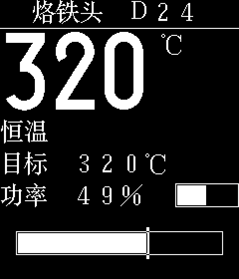
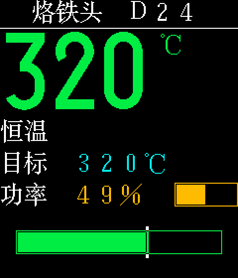
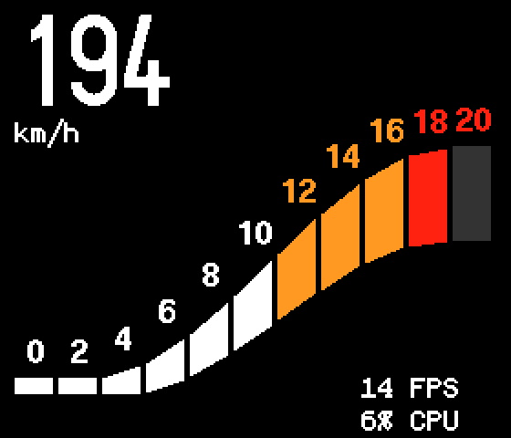

# clut_dma on a Cortex-M1

The ARM build of the prototype: [`rtl/clut_dma.v`](../../rtl/clut_dma.v) with a Gowin Cortex-M1 soft core on a Tang Nano 20K, driving a WeAct ST7789 240×280 display.
This is the build in the video of the [main page](../../README.md).
For the engine itself, see [rtl/README.md](../../rtl/README.md).

## Hardware

Gowin Cortex-M1 at 54 MHz with 32 KiB ITCM and 32 KiB DTCM.

| address | |
|---|---|
| 0x60000000 | APB: clut_dma registers, through `rtl/apb_reg_slave.v` |
| 0x60000040 | APB: spi_lcd, SPI master for the display, with backlight PWM |
| 0x60000080 | APB: GPIO |
| 0x80000000 | AHB: fbmem, 16 KiB dual-port block RAM |
| 0x50004000 | UART0, to the USB serial of the board |

The Cortex-M1 on this FPGA has one APB and one AHB extension slot, and no way for a peripheral to read its RAM.
So the frame buffer, tile map and CLUT are in fbmem: the CPU writes them over AHB, clut_dma reads the second port of the block RAM.
`rtl/clut_fabric.v` puts clut_dma, fbmem and spi_lcd on these two slots.

The firmware is loaded into ITCM over SWD and started with a reset of the core (`openocd`, `m1.cfg`).

## Wiring

| signal | FPGA pin | header | display |
|---|---|---|---|
| GND | | J6 20 | GND |
| 3V3 | | J6 19 | VCC |
| lcd_sck | 18 | J6 18 | SCL |
| lcd_mosi | 19 | J6 17 | SDA |
| lcd_rst_n | 20 | J6 16 | RES |
| lcd_dc | 17 | J6 15 | DC |
| lcd_cs_n | 31 | J6 14 | CS |
| lcd_bl | 30 | J6 13 | BLK |
| swclk | 73 | J6 1 | SWD probe |
| swdio | 74 | J6 2 | SWD probe |
| mark | 16 | J6 7 | timing mark, high during a transfer |

The display module plugs onto J6 pins 13 to 20, its GND on pin 20, and is powered from 3V3 on pin 19.
Pins 17 to 20 also drive the onboard leds 2 to 5.
The SWD probe takes its GND and VTref from J5 pin 15 (GND) and pin 16 (3V3).

If the display module has a 3.3 V LDO, it can be powered from 5 V. The logic stays at 3.3 V.

## Requirements

Besides the [common requirements](../../rtl/README.md#requirements):

- Gowin EDA (tested V1.9.12.02 SP2, `/opt/Gowin_V1.9.12.02_SP2`, or
  `make GWPATH=...`) for the bitstream. The Cortex-M1 is Gowin IP and is
  not included: in the Gowin IDE, open the project `tang_nano_20k_arm.gprj`
  (only the device and the core); in the IP Core Generator, load
  `src/gowin_empu_m1/gowin_empu_m1.ipc` and generate
  `src/gowin_empu_m1/gowin_empu_m1.v`. The bitstream is built with `make`,
  not in the IDE.
- openFPGALoader, to load the bitstream.
- arm-none-eabi-gcc (tested xPack 14.2.1) and OpenOCD (tested xPack
  0.12.0) with a CMSIS-DAP probe, for the firmware. Paths in
  `fw/Makefile`: `CROSS`, `OPENOCD`.
- Python 3 with Pillow, for `make sim`.

## Use

In this directory:

```
make               # bitstream, impl/pnr/clut_m1.fs
make load          # into the sram of the fpga
make flash         # into the flash of the board
./size.sh          # LUTs, ALUs, flip-flops and block RAMs of clut_dma: the
                   # processor alone, without clut_dma, and the whole design
```

In `fw/`:

```
make load          # test: cpu fills, then clut_dma test pattern and rectangles
make border        # test: a colored line on each border
make palette       # u8g2 ClutPalette
make clutcolor     # u8g2 ClutColor, a dashboard updated every second
make clutclock     # u8g2 ClutClock, an analog clock
make graphics      # u8g2 demo_graphics, the GraphicsTest pages
make mui           # u8g2 demo_mui, a menu; keys over the uart
make stars         # Adafruit GFX falling stars, 1 bpp, row layout
make async         # an auto gauge, one request per screen, interrupt driven
make demo          # the examples one after the other, then a walk through the
                   # menu with keys over the uart; waits for enter, for a video
make term          # serial terminal on UART0, /dev/ttyUSB1, 115200 baud
make sim TEST=...  # the image the display ought to show, from a simulation of
                   # the rtl: border, palette, clutcolor, clutclock, graphics,
                   # mui, stars, solder
```

The firmware: test images, and the color examples of the u8g2 branch `clut`
(ClutPalette, ClutColor, ClutClock, demo_graphics, demo_mui) through
clut_dma (`testimg.c`). The u8g2 examples, and the soldering station, are
u8g2 applications like any other: the u8g2 ST7789 driver sends a tile row at
a time, and `u8x8_clut_dma.c` replaces the software color expansion of u8g2
with clut_dma (see [Soldering station demo](#soldering-station-demo)). The
u8g2 examples draw in the vertical layout of u8g2, the test images in row
layout. The CLUT of u8g2 is in the memory of clut_dma,
64-byte aligned (`u8g2_SetClutTable()`), with the standard VGA colors
(`u8g2_SetClutDefaultColors()`). u8g2 itself has no default table: without
one, white on black. `stars.cpp`: falling stars drawn with Adafruit GFX on a
`GFXcanvas1`, 1 bpp in row layout, with a tile map and CLUT next to the
canvas; the Arduino headers Adafruit GFX needs are stubs in `fw/arduino/`.
`host.c` builds the same test on the PC, for the simulation.

## Per-character color

clut_dma colors per 8×8 tile: the tile map gives each tile one of the 16 foreground/background pairs of the CLUT.
A character can have its own colors if it covers whole tiles and shares no tile with its neighbors.
Rules for the application:

- Glyph size a multiple of 8: 8, 16, 24 or 32 pixels. A 24×24 glyph is 3×3 tiles.
  At 12 pixels a glyph is 1.5 tiles, and neighboring characters share tiles.
- Monospaced: the advance width a multiple of 8, also for Latin letters and digits.
  A half-width Latin font of 12 pixels shifts everything after it off the grid;
  use Latin of 8 or 16 pixels wide, or pad mixed strings to a multiple of 8.
- Drawn at x and y multiples of 8. u8g2 positions text on the baseline:
  with `u8g2_SetFontPosTop()`, the font's ascent plus descent must equal the glyph height, so that the top of the cell lands on the grid.
- The ink inside the cell. A font drawn for its size (e.g. the 24×24 bitmap font gb24st) has this by design;
  an outline font rasterized to 24 pixels may spill into the neighboring tiles.

Limits:

- At most 16 color pairs on screen at a time.
- The pair applies to the whole tile, background included: a character with another background shows as a colored box.
  That suits a highlight; otherwise give all pairs the same background.
- Content off the grid (large digits, lines, bars) works as well; its color is per tile region, not per glyph
  (`u8g2_SetClutRegion()`).

The color costs no RAM per character: the tile map covers the whole screen anyway, 450 bytes for 240×240.

## Build options

- `LCD_DIV`: SPI clock, 54 MHz / (2 * LCD_DIV), default 1.
- `LCD_BRIGHT`: backlight, n/256, default 128.
- `LCD_MADCTL`: 0x00: connector at the top, 0xC0: at the bottom.
- `PAGE_ROWS`: u8g2 page buffer of 1 or 2 tile rows for clutclock,
  graphics and mui, default the full screen.

Change an option with `make -B` or after `make clean`.

## ClutClock demo

Screen update of ClutClock, measured on the board: the whole clock drawn by u8g2 and the whole screen sent, 240×280 in RGB444, SPI at 27 MHz.

| u8g2 buffer | RAM | draw and send |
|---|---|---|
| 1 tile row (`PAGE_ROWS=1`) | 1,521 bytes | 136 ms |
| 2 tile rows (`PAGE_ROWS=2`) | 1,761 bytes | 90 ms |
| full screen | 9,681 bytes | 43 ms |

RAM: the bitmap (240, 480 or 8,400 bytes), the tile map (525 bytes) and the CLUT (64 bytes), plus 692 bytes of variables and stack (the highest stack
use measured).

The code is in ITCM and not counted.

In all three cases, sending the whole display takes 32.2 ms: 29.9 ms of pixels over SPI, and the window commands of the 35 tile rows.
The rest of the time is drawing; in page mode u8g2 draws the clock once per page.
ClutClock waits for each transfer to end, so drawing and sending do not overlap.

Conclusion: using less memory means lower speed.

## Falling stars demo

Falling stars, measured on the board: 24 stars of 16×16 pixels drawn by Adafruit GFX, 240×280 in RGB444, SPI at 27 MHz.
The demo changes mode every 10 seconds, between updating individual stars or updating the whole screen.

| sent per frame | frames per second | clut_dma | draw and send |
|---|---|---|---|
| per star: the tiles each star left and entered, 24 requests | 50 (the set rate) | 4.9 ms | 18.7 ms |
| the whole screen, 1 request | 23 | 29.9 ms | 43.3 ms |

Where two stars share the same 8×8 tile, the tile has the color of one of them.

Conclusion: it is faster to update only the changed parts of the display.

## Soldering station demo

A soldering station in 24×24 Chinese (`fw/solder.c`): a home screen with the tip temperature, the status, the set temperature and the heater power, and a settings menu (u8g2 mui).
The layout follows [OpenT12](https://github.com/createskyblue/OpenT12); no code or images of it are used.
The soldering iron is simulated: the heater warms the tip, the tip loses heat to the room, a controller holds the set temperature.

 

The same frame in black and white and in color, from `make sim TEST=solder`: the bitmap is the same, only the CLUT and the tile map differ.

Text is in gb24st, a 24×24 bitmap font (ISAS Song ti, GB2312), with the full-width Latin letters and digits at their ASCII codes: every character is 3×3 tiles on the grid of clut_dma.
`fw/font/gb24st.sh` makes `fw/font/u8g2_font_gb24st_t_solder.c` from the characters in `fw/font/solder.txt` (fontforge, bdfconv); a 24×24 Chinese character takes about 68 bytes.
The temperature is in u8g2 logisoso78.

`solder.c` is a u8g2 and mui application like any other: the u8g2 ST7789 driver, the u8g2 picture loop, and a byte function from the platform (the SPI).
clut_dma comes in through one file, `fw/u8x8_clut_dma.c`: its `u8x8_clut_stream_rgb444()` writes the clut_dma registers and starts it, in place of the software version in u8g2, a weak function.
The driver sets the window for each tile row and calls it; clut_dma reads the tiles, the tile map and the CLUT, and sends the pixels.
Without `USE_CLUT_DMA` the file is empty and the CPU expands the colors.
The file is linked as an object, not from a library; in an Arduino sketch, the function needs C linkage (`extern "C"`).

In `fw/`:

```
make solder        # the demo; keys over the uart (make term)
make demo-solder   # with keys sent over the uart, for a video (solder_demo.sh);
                   # OPTS: build options, default COLOR=1, OPTS= black and white
make sim TEST=solder COLOR=1   # the frames the display ought to show, from a simulation of the rtl
../../measure_solder.sh arm    # every variant below on the board, key b; no terminal open
```

Keys: `w` `s` set temperature, space or enter: menu, `e` sensor fault, `b` benchmark: 50 frames back to back.
In the menu: `w` `s` field, `a` `d` value, enter on 返回: back.

Build options of `make solder`; change an option with `make -B` or after `make clean`:

| option | |
|---|---|
| `PAGE_ROWS=n` | the u8g2 buffer: n tile rows, default 2; 35 the full screen |
| `COLOR=1` | a tile map and a CLUT of 16 pairs; else black and white (`NO_MAP`, the CLUT one word) |
| `USE_CLUT_DMA=0` | no clut_dma: the CPU expands the colors with `u8x8_clut_stream_rgb444()` of the u8g2 branch `clut` and writes the bytes to the SPI; default 1, clut_dma (`fw/u8x8_clut_dma.c`) |

Measured with `../../measure_solder.sh arm`: Cortex-M1 at 54 MHz, SPI at 27 MHz, 240×280, key `b`.
RAM for the display: the bytes in fbmem.
CPU time for sending: the time per frame the CPU spends sending the picture, everything but the drawing: the window commands, and in software the color expansion and every byte to the SPI (busy), with clut_dma the wait until it is done (waiting: with an interrupt the CPU could do other work).

| variant | RAM for the display, b/w / color | per frame, b/w / color | CPU time for sending, color |
|---|---|---|---|
| software, 2 rows | 488 / 1,072 bytes | 151.4 / 153.5 ms | 91.1 ms, busy |
| 1 row | 248 / 832 bytes | 133.0 / 133.2 ms | 32.2 ms |
| 2 rows | 488 / 1,072 bytes | 93.9 / 94.0 ms | 32.2 ms |
| full screen | 8,408 / 8,992 bytes | 57.9 / 58.0 ms | 32.2 ms |

- Color costs RAM, not time: with clut_dma, black and white and color take the same time. The CPU draws in black and white either way, and clut_dma reads the map and CLUT words beside the bitmap; the SPI stays the limit.
- Sending a whole screen takes 32.2 ms: 29.8 ms of pixels (240×280 in RGB444 at 27 MHz), and the window commands the u8g2 driver sends before each of the 35 tile rows. The CPU waits for it.
- Fewer tile rows take less RAM and more time: u8g2 draws the whole screen once per page.
- The drawing time varies by a few ms with what is on the screen; the figures are from one run.
- Variables: 348 bytes (u8g2 and mui 296). The highest stack: 656 bytes with clut_dma, 744 in software, with the menu. Code and fonts: about 15 kB in ITCM.

## Auto gauge demo



An auto gauge (`fw/async.c`, `make async`): the whole screen in one clut_dma request, interrupt driven; the CPU sleeps while the screen is sent.
Adapted from 06-Auto-Guage of [nishad2m8/T-Display-S3-YT](https://github.com/nishad2m8/T-Display-S3-YT), an LVGL gauge on a LilyGO T-Display S3; here in 1 bpp with colors per tile, drawn with u8g2, in landscape, 280×240 (MADCTL with MV, `ASYNC_MADCTL`; only this demo).
The image: fbmem read from the board, at twice the size, as clut_dma sends it (here the RISC-V build).

The CLUT does the animation.
The band is drawn once: 11 segments, each in its own three tile columns and its own CLUT entry; a segment is lit or dim by its CLUT entry alone, without drawing.
The scale numbers are in tiles of their own and do not change.
Per frame, between two sends, only what changed: the CLUT entries of the segments, the digit cells of the speed, the FPS and CPU % lines.
Then one request for the whole screen, and `wfi` until the clut_dma interrupt (IRQ 10, `EXTINT[0]`).

Measured over a whole drive cycle; FPS and CPU % as on the display, smoothed over about 64 frames:

| | Cortex-M1, 54 MHz, SPI 27 MHz | GoRV32, 24 MHz, SPI 12 MHz |
|---|---|---|
| send of a whole screen | 29.9 ms | 67.2 ms |
| frames per second | 30 to 32 | 14 |
| CPU | 3.5 to 10 % | 3.5 to 6 % |

- RAM for the display: 8,989 bytes, the buffer (8,400), tile map (525) and CLUT (64).
- The SPI is the limit. A frame is the send of the screen, and the changes, which wait for the end of the send: clut_dma reads the buffer and the CLUT while it sends. The CPU sleeps the rest.
- The CPU % is low because only a few digits are drawn per frame; a screen drawn anew every frame costs more.
  Nearly all of the CPU time is drawing the speed digits; switching segments in the CLUT takes 5 µs per frame, starting the send 9 µs (Cortex-M1).
- The original redraws its labels on every pass of its loop; LVGL limits the screen to one refresh per 30 ms. Here the send of the screen is the limit.
