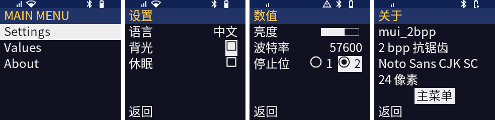

# mui_2bpp

A minimal u8g2 for a frame buffer of 2 bits per pixel, enough to run
[mui](https://github.com/olikraus/u8g2/wiki/muimanual) menus with
anti-aliased fonts. English and Chinese, Noto Sans CJK SC at 24 pixels; the
icons of a status row and the controls (checkbox, radio button) from
Material Symbols, outline.



Below mui (`mui.c`, `mui_u8g2.c`) a new u8g2 of the calls mui makes,
drawing in the 2 bpp bitmap of clut_dma (CTRL BPP2) and filling its tile
map and clut. Below that, the u8x8 layer of u8g2 with its ST7789 driver,
unchanged.

A menu is drawn with three things only:

- **glyphs**: the text, and the controls, from fonts, anti-aliased;
- **the tile map**: the color of each 8x8 tile. The rows of the screen have
  roles; the field with the focus, the value being edited and a button are
  a color of their tiles, not a drawing;
- **the clut**: a foreground, a background and two blends per role,
  computed by the compiler, set once at the start.

Boxes and frames are drawn only for the bar fields of mui.

## Files

| directory | |
|---|---|
| `src/` | the library: `u8g2.h`, `u8g2_2bpp.c` (roles, pages, boxes, text, controls), `u8g2_button.c` (the button functions mui calls; the bar of a field is a color), `u8x8_clut_2bpp.c` (the colors in software) |
| `mui/` | `mui.c mui.h mui_u8g2.c mui_u8g2.h`, from u8g2 branch clut, commit 07676acf, with `MUI_U8G2_GRID` and `MUI_U8G2_2BPP` in `mui_u8g2.c`, the same as in the branch (not yet committed there) |
| `u8x8/` | the u8x8 files the library needs, same commit, unchanged |
| `tools/` | `cstrings.py`, `fontconv.py`, `icons.py`: the fonts; `clutline.py`: the colors of a role, for a compiler other than GCC |
| `font/` | Noto Sans CJK SC, Material Symbols, their licenses (`README.md`) |
| `demo/` | a menu in English and Chinese, on the PC; the generated fonts |

## Frame buffer

Row layout: a pixel row is `U8G2_LINE_STRIDE` = 2 × tile columns bytes, 4
pixels to a byte, the leftmost in bits 7:6. A pixel is 0 background, 1 a
third, 2 two thirds, 3 foreground. A clut entry is two 32-bit words, as
clut_dma reads them: code c in entry i is word `clut[i][c >> 1]`, bits 15:0
when c is odd, 31:16 when even.

The codes are the coverage. The engine itself only selects a word and a
halfword of the clut entry; the clut gives the codes their colors.

The screen is set at compile time: `U8G2_DISPLAY_WIDTH`,
`U8G2_DISPLAY_HEIGHT` (240×240), and `U8G2_PAGE_ROWS`, the tile rows in the
buffer (default: all, one page is the screen). The buffer is
`U8G2_BUF_SIZE` bytes: 14,400 for the screen, 480 per tile row.

A focus change (Next, Prev) redraws and sends only the tile rows of the
field that had the focus and of the field that has it: one span of rows,
from `u8g2_FirstRows()`: 8 tile rows instead of 30 for the next field, the
rows from one field to the other for fields further apart. Every other
change, a list that scrolls, and a field whose rows are not known redraw
and send the whole screen; new status icons only the status row
(`U8G2_STATUS_ROWS`, 2 tile rows). With the full
buffer the rows are drawn in place; with a page buffer, a buffer of at
least the height of a field (4 tile rows, 1,920 bytes) draws a field in one
pass.

Compared to 1 bpp, the buffer doubles: with tile map and color lookup table, 17.0 KB for a full buffer of 240×280.
Using less memory, but up to 12 % slower: a buffer of only one line of text, 2.5 KB for a 240 pixel wide display.

RAM for the display, 240×280: the buffer, the tile map and the color lookup table (KB = 1024 bytes).

| RAM | mode | buffer | |
|---|---|---|---|
| 0.8 KB | 1 bpp | one tile row | smallest; slowest, the screen drawn in 35 passes |
| 1.1 KB | 2 bpp | one tile row | anti-aliased; slow, 35 passes |
| 2.5 KB | 2 bpp | one line of text, 4 tile rows | anti-aliased; draw one line of text in one pass |
| 8.8 KB | 1 bpp | full screen | fastest at 1 bpp; the picture stays in memory: color change without redrawing |
| 17.0 KB | 2 bpp | full screen | fastest at 2 bpp; the picture stays in memory: color change without redrawing |
| 131.2 KB | RGB565 frame buffer, for comparison | | |

## Roles

`u8g2_SetupClut2bpp(u8g2, map, clut)`: the library fills the tile map and
the clut, in memory of the application (fbmem, for clut_dma).
`u8g2_SetRoleColor(u8g2, role, fg, bg)`, rgb888 constants, once for each
role: the blends at a third and two thirds are mixed in linear light, gamma
2.2 (`U8G2_GAMMA`): each channel to the power 2.2, mixed, back with the
power 1/2.2. Mixing the sRGB values directly makes light text on a dark
background too thin: white on black, 85 and 170 instead of 155 and 212.
The compiler computes the colors, in the native format of the display
(`U8G2_CLUT_NATIVE`, 444 for the ST7789 driver); setting a role is two
stores of constant words. A color that is not a constant is a compile
error.

`u8g2_SetRoleColor()` needs GCC: math builtins in a static initializer.
With another compiler, `tools/clutline.py FG BG` computes the four colors
with the same formula, for `u8g2_SetRoleClut(u8g2, role, c0, c1, c2, c3)`,
which sets the four colors of a role directly, in the native format.

| tile rows | pixels | role |
|---|---|---|
| 0 - 1 | 0 - 15 | `U8G2_ROLE_STATUS` |
| 2 - 5 | 16 - 47 | `U8G2_ROLE_TITLE` |
| 6 - 25 | 48 - 207 | `U8G2_ROLE_CONTENT`, 5 rows of 32 pixels |
| 26 - 29 | 208 - 239 | `U8G2_ROLE_BACK` |

(`U8G2_STATUS_ROWS`, `U8G2_TITLE_ROWS`, `U8G2_BACK_ROWS`.) The roles of the
rows separate the parts of a menu; a rule (`mui_hline`) is not needed.

Where mui draws the bar of a field (`u8g2_DrawButtonFrame()`), the tiles
under the bar take a role:

| flags | role | in mui |
|---|---|---|
| `U8G2_BTN_INV` | `U8G2_ROLE_INVERTED` | the field with the focus |
| `U8G2_BTN_INV`, `U8G2_BTN_XFRAME` | `U8G2_ROLE_EDIT` | the value being edited |
| a border | `U8G2_ROLE_BUTTON` | a button of the fi style |

The edges of a bar round outward to tile edges; the pixel of padding of
mui is ignored. The bar is one tile wider at each end, and its four corner
tiles take a corner role (`U8G2_ROLE_INVERTED_CORNER`, `_EDIT_CORNER`,
`_BUTTON_CORNER`: the bar color on the screen color) with a quarter disc
of radius 7 drawn in each: rounded corners as in LVGL (`u8g2_MarkBar()`).
The forms keep a free tile at each end of a field that can have the
focus. Only the corners are drawn; the rest of the bar is a color of its
tiles. A focus change redraws the rows of both fields, the corners with
them.

## Styles of mui fields

`MUI_U8G2_2BPP` (defined by `u8g2.h`) changes the four style functions of
`mui_u8g2.c`, so that every field shows its state as a color:

| style | fields | unfocused | focus | edit |
|---|---|---|---|---|
| pi | 28 | plain | focus color | edit color |
| pf, if | 13, 6 | as pi | | |
| fi | 9 buttons | button color | focus color | edit color |

In u8g2, pf shows the focus as a frame and if inverts the fields without
focus; here all styles look alike. An option line shows its value at the
right of its field; a checkbox or a radio button has a gap of 8 pixels
before its text.

## Controls

`u8g2_SetControlFont(u8g2, font)`: the checkbox, the radio button and the
mark of the chosen value of a list are glyphs of this font, drawn by
`u8g2_DrawControl()`, centred in the box of mui (ascent pixels square, on
the baseline). `MUI_U8G2_2BPP` makes the helpers of `mui_u8g2.c` call it:

| control | glyph (Material Symbols) |
|---|---|
| checkbox | `check_box_outline_blank`, `check_box` |
| radio button | `radio_button_unchecked`, `radio_button_checked` |
| the chosen value of a list | `radio_button_checked` |

## Library

Setup and display: `u8g2_Setup_st7789_240x280()` (a 240×240 screen on the
240×280 panel), `u8g2_SetupDisplay2bpp()`, `u8g2_InitDisplay()`,
`u8g2_SetPowerSave()`, `u8g2_SetFlipMode()` (rotation by 180 degrees, in
the display), `u8g2_ClearDisplay()` (all of the panel).

Colors: `u8g2_SetupClut2bpp()`, `u8g2_SetRoleColor()`, `u8g2_MarkTiles()`;
without roles `u8g2_SetClutMap()`, `u8g2_SetClutTable2bpp()`.

Drawing: `u8g2_FirstPage()`, `u8g2_FirstRows()`, `u8g2_NextPage()`,
`u8g2_ClearBuffer()`, `u8g2_GetBarRows()` (the tile rows of a field),
`u8g2_SetFont()`, `u8g2_DrawStr()`, `u8g2_DrawUTF8()`,
`u8g2_GetStrWidth()`, `u8g2_GetUTF8Width()`, `u8g2_SetControlFont()`,
`u8g2_DrawControl()`, `u8g2_DrawButtonFrame()`, `u8g2_DrawButtonUTF8()`;
for the bar fields `u8g2_DrawBox()`, `u8g2_DrawFrame()`, and
`u8g2_DrawHLine()` for `mui_hline`. For pages of the application:
`u8g2_DrawLine()`, as in u8g2 but anti-aliased (Xiaolin Wu, integers only,
`src/u8g2_line.c`), `u8g2_DrawCircle()` and `u8g2_DrawDisc()`, as in u8g2
with the quarters of `option`, anti-aliased by coverage, integers only
(`src/u8g2_circle.c`), and `u8g2_DrawPixelLevel()`, a pixel of level 0 to 3. A glyph pixel takes the larger of its
level and the one below; a box sets its pixels to 3. There are no draw
colors.

A field that needs a function of u8g2 the library does not have fails to
link, with the name of the function. The library is meant to be linked with
`-ffunction-sections` and `--gc-sections`: the fields of mui that are not
used, and what only they call, are left out.

## Forms

`MUI_U8G2_GRID` 8 (in `mui_u8g2.c`, set by the Makefile): the positions of
the forms are in units of 8x8 tiles; widths in the arg of a field stay in
pixels. Baselines in tile rows: the title 5, the content 9, 13, 17, 21,
25, Back 29.

The font has ascent 24 and descent 6 (`fontconv.py -a 24 -d 6`): mui draws
the bar of a focused field ascent + descent + 2 = 32 pixels high, from
ascent + 1 above the baseline; it covers the 4 tile rows from 3 above the
baseline. The descenders of g, j, p, y reach 6 rows below the baseline;
only | reaches 7, into the bottom row of the bar, and fontconv.py says so.
A bar field (`u8_bar`, `u8_fixed_width_bar`) has a full row too: the bar
2/3 of the ascent high, 16 pixels, 6 pixels inside the bar of its focus,
else the focus color would hide it. It is drawn as the slider of LVGL, no
frame: the track at code 1 and the indicator at code 3, in tiles of
`U8G2_ROLE_SLIDER`, a role of 4 colors of its own
(`u8g2_SetRolePalette()`); with the focus or in edit mode the focus or edit
role takes the tiles over. Fields of the
whole width (menu lines, Back) have bars across the screen; other fields
color the tiles their bar covers. A field that can have the focus needs
tiles of its own: a label must not share them.

## Fonts

```
tools/cstrings.py -o chars.txt forms_en.c forms_zh.c
tools/fontconv.py -s 24 -a 24 -d 6 -m 32-126 -n font_noto_sc_24 \
    -o font_noto_sc_24.c -p font.png font/NotoSansCJKsc-Regular-subset.otf chars.txt

tools/icons.py -o icons.h font/MaterialSymbolsOutlined.codepoints battery_full wifi ...
tools/cstrings.py -o icon_chars.txt icons.h
tools/fontconv.py -s 20 -a 18 -d 0 -n font_icons_20 \
    -o font_icons_20.c font/MaterialSymbolsOutlined-Fill0-opsz20.ttf icon_chars.txt

tools/icons.py -o controls.h font/MaterialSymbolsOutlined.codepoints check_box_outline_blank ...
tools/cstrings.py -o control_chars.txt controls.h
tools/fontconv.py -s 28 -n font_controls_28 \
    -o font_controls_28.c font/MaterialSymbolsOutlined-Fill0-opsz20.ttf control_chars.txt
```

`cstrings.py`: the characters of the string literals, not those of the
comments. `fontconv.py`: those characters and the ranges of `-m`, rendered
by FreeType, rounded to the four levels; `NAME.c` and `.h`, and with `-p`
a picture of the glyphs. The font format is in `fontconv.py`. `icons.py`:
`#define ICON_BATTERY_FULL ""`, a string literal per icon, for
`u8g2_DrawUTF8()` and for `cstrings.py`.

For the demo: the text 130 glyphs, 35 of them Chinese, 10,410 bytes; the
icons 18 glyphs, 928 bytes; the controls 4 glyphs at 28 pixels, 536 bytes,
20x20 pixels of ink. An icon at 20 pixels has 16 pixels of ink, 18 to 2
rows above the baseline: the status row, baseline at y 18.

## Build

```
make pattern      # all four codes, three clut entries, through the ST7789
                  # driver to st7789.py, compared with the formula of clut_dma
make demo         # the menu, a list of keys: build/demo/frame_NN.png
make font         # the fonts, when the forms, icons or controls change
make fig          # the figures of the READMEs, ../fig/mui2bpp-*.png, from frames of the menu
make size         # the demo for a Cortex-M1, stubs for SPI and keys
make PAGE_ROWS=8 pattern demo size    # a page buffer of 8 tile rows: two menu rows
```

On the PC the display is `../fpga/tb/st7789.py`, drawing the bytes the u8x8
driver sends; `build/demo-names.txt` lists the key of each frame.

- `make pattern`: 0 of 67,200 pixels differ, with the screen in one page and
  with pages of 1, 7 and 8 tile rows.
- `make demo`: the frames are the same with pages of 1, 7 and 8 tile rows as
  without.

`make size`, Cortex-M1, `-Os`: 24,082 bytes of code and constants (ITCM).
RAM: the buffer, the tile map and the clut (14,978 bytes, in fbmem on the
board), and the variables. With `PAGE_ROWS=8` the buffer is 3,840 bytes,
with `PAGE_ROWS=1` 480.

## RAM

RAM was measured as following:

- fill free RAM with a pattern (0xDEADBEEF)
- run `make demo-menu`
- find the deepest word the stack overwrote

Sizes in bytes.

| board | colors | display RAM | other variables | highest stack | RAM in all | code and data |
|---|---|---|---|---|---|---|
| RISC-V, 24 MHz, page of 4 tile rows | clut_dma | 2,498 | 282 | 648 | 3,428 | 25,976 |
| RISC-V | CPU | 2,498 | 282 | 772 | 3,552 | 26,304 |
| Arm, 54 MHz, full buffer | clut_dma | 14,978 | 196 | 664 | 15,838 | 24,976 |
| Arm | CPU | 14,978 | 196 | 728 | 15,902 | 25,048 |

Display RAM: the buffer, the tile map and the clut. The buffer is most of
the RAM; the rest is under 1 KB. Expanding the colors in the CPU takes
64 to 124 bytes more stack.

## Comparison

Comparison of two menu systems with anti-aliased text. RISC-V. 240×240 display.

| | clut_dma + mui_2bpp | LVGL |
|---|---|---|
| code, without fonts | 12.2 KB | 148.7 KB |
| total RAM | 3.3 KB | 32.1 KB |

Code: the library, the display driver and the menu, without fonts. RAM: display buffer, variables, heap and stack.

## Demo

`demo/menu.c` is the menu, the same on the PC and on a board: the fields,
the colors of the roles, the status row and the language. As in
arm_can_tool, where a new language takes effect after a reboot, the menu
starts again in the other language. The forms have menu lines, option
lines with the value at the right, checkboxes, a bar, two radio buttons, a
button and Back. The back row has the colors of the content.
The about form shows numbers, each only when it is known (not 0): the
cpu and its clock, the memory for the display (computed, KB of 1024
bytes), the code (from the linker, set by the board) and, measured on a
board built with `STATS=1`, the last focus change and the last whole
screen; `menu_about_line()` in `demo/menu.c`, the globals in `menu.h`,
integers only. `make FULL=1 demo`: every key the whole screen, the
reference for the frames of a partial update.
`demo/main_host.c` is the PC side: a list of keys and of new status icons,
a frame after each.
